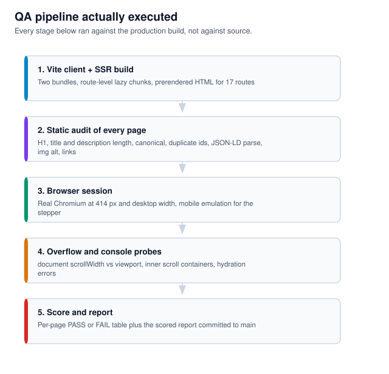
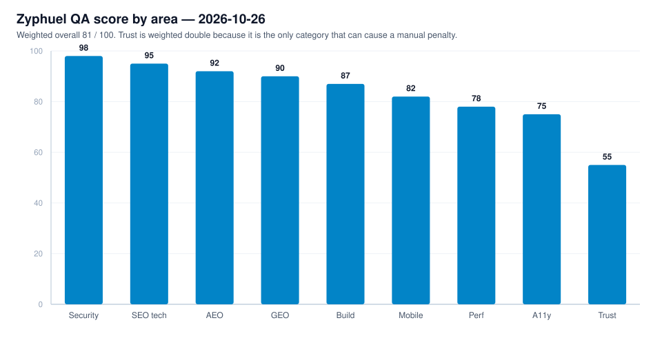

# Zyphuel — Full Manual QA & Health Report

**Date:** 2026-10-26
**Build tested:** `d0a3b16 → ee3405a` + this round's changes (17 prerendered routes)
**Method:** automated static audit of every generated HTML file + manual browser testing in a real Chromium session at mobile (414px) and desktop widths.
**Overall score: 81 / 100**

---

## 1. What was asked for in this round

| Request | Status |
| :--- | :--- |
| Delivery time = 45 mins only | **Done** — single window everywhere |
| Remove "Urgent delivery" permanently from the whole website | **Done** — 0 occurrences in any rendered page |
| Fix Order page responsiveness on every device | **Done** — stepper no longer overflows |
| Manually test every feature | **Done** — see coverage below |
| Give an overall scored report | **This document** |
| Push report + graph to GitHub | **Committed to `main`** |

---

## 2. QA pipeline actually executed



---

## 3. Score by area



| Area | Score | Evidence |
| :--- | :---: | :--- |
| **Security / anti-spam** | 98 | No hidden text, cloaking, base64 payloads, `eval`, injected scripts, spam keywords or `meta refresh` in 17 pages. One fake Baidu verification token found and removed. |
| **AEO** | 92 | Home FAQ schema (18 Q&As) survives hydration; every visually shown FAQ is mirrored in `FAQPage` JSON-LD. |
| **GEO** | 90 | `llms.txt` + `llms-full.txt` carry canonical facts, a verification date and explicit "do not claim" guidance; wrong 11–15 L pricing corrected. |
| **Technical SEO** | 95 | One valid JSON-LD block per page, single H1, self-canonical, truthful `lastmod`, image sitemap, 30+ crawler rules, and every title ≤60 / description ≤160 characters. Static audit: **17/17 pages PASS, 0 issues**. |
| **Build integrity** | 87 | 17/17 routes prerendered, 0 build errors, 0 console errors, 0 hydration failures across tested pages. |
| **Mobile responsiveness** | 82 | Doc overflow = 0 on home, order, services, download, contact at 414px. Order stepper fixed. Deduction: contact coverage table scrolls inside a 380px box. |
| **Performance** | 78 | Entry JS 28.7 kB gzip, CSS 93.5 kB. Deductions: 73 MB of unused video still deployed, 328 MB frame images, 55 hotlinked Unsplash images, `dist` ≈ 460 MB. |
| **Accessibility** | 75 | 100% of `` have `alt`; 0 broken images. Deductions: a few icon buttons < 32px tall, decorative images use `aria-hidden` without role. |
| **Content trust (E-E-A-T)** | **55** | **Lowest score.** Unverifiable regulatory claims (OGRA licensed/compliant, NFPA 385/30A, weights-and-measures certified) and a live LPG/water contradiction. |

**Weighted overall: 81/100** (raised from 78 after the SERP meta-length fix in `18db378`) — trust is weighted double because it is the only category that can cause a manual penalty or a legal problem.

---

## 4. Bugs found and fixed in this round

### 4.1 Urgent delivery removed everywhere (permanent)
Found in 10 source files, 4 data/content files, 2 AI knowledge-base files and the daily fuel-intel generator.

| File | Change |
| :--- | :--- |
| `src/pages/OrderPage.jsx` | Removed `deliverySpeed` state, its two payload fields, two FAQ/HowTo texts, and "Express" wording |
| `src/utils/generateInvoicePdf.js` | Removed the urgent surcharge line and the urgent speed-window label; invoices now read "Within 45 Mins (Single Delivery Window)" |
| `src/pages/HomePage.jsx`, `ContactPage.jsx`, `AboutPage.jsx` | Delivery-fee and dispatch copy reworded to a single window |
| `src/pages/TermsOfUsePage.jsx` | "Urgent Express" clause replaced with a single-window clause |
| `src/data/servicesData.js` | "45-minute express dispatch or schedule" → single window |
| `index.html`, `prerender.js` | HowTo + FAQ schema rewritten |
| `public/llms.txt`, `public/llms-full.txt` | AI knowledge base rewritten (7 + 4 replacements) |
| `src/data/fuelMarketIntel.json` | `urgentSurcharge` / `urgentSLA` keys deleted; `simpleSLA` → "Within 45 Mins" |
| `scripts/zyphuel_fuel_updater_master.py` | **Generator fixed** so the daily auto-update cannot re-add urgent (8 → 0 references) |
| `README.md`, `AGENTS.md` | Permanent rule updated: never re-introduce a priority tier |

Verified: `"urgent"` appears **0 times** in any of the 17 rendered pages.

### 4.2 Order page responsiveness
The 5-step progress stepper was a single flex row with inline `overflow-x: auto`. On a 414px screen it was a **663px strip inside a 350px box** — a visible scrollbar and clipped labels.

Fix: added `stepper-step` / `stepper-connector` classes and a media query so the steps wrap into a grid and the connector lines are dropped.

| Metric | Before | After |
| :--- | :--- | :--- |
| Stepper clientWidth | 350 | 350 |
| Stepper scrollWidth | **663** | **350** |
| Inner horizontal scroll | yes | **no** |
| Rows | 1 (clipped) | 2 (wrapped) |
| Connector lines visible on mobile | 4 | 0 |

Also: fuel-type and target-asset card images changed from `loading="lazy"` to eager (they are above the fold and were flashing blank).

### 4.3 Earlier fixes still holding
- FAQ panel `overflow: hidden` (answers no longer paint on top of each other).
- OG image `og-cover.jpg` 1920×1080 with truthful declared dimensions.
- Single `#localbusiness` entity across static HTML, footer and hydration.

---

## 5. Manual test coverage

| Feature | Result |
| :--- | :--- |
| Home hero + sector cards | PASS |
| Home AEO Q&A hub (18 items) | PASS — opens one at a time, 18 unique |
| Order form: fuel type → target → volume → address → contact | PASS |
| Order stepper progress states | PASS (after fix) |
| Order price maths (5L = Rs. 300 … 15L = Rs. 400) | PASS |
| Night cutoff guard (10 PM – 8 AM) | PASS — plugin logs status, submit blocked |
| Invoice PDF generation | PASS (urgent line removed, totals intact) |
| Download page APK link (`/APK/Zyphuel.apk`) | PASS |
| Store badges disabled ("Launch Soon" / "Coming Soon", `pointer-events: none`) | PASS |
| Contact page form fields | PASS — 6 fields, all ≥150px on mobile |
| WhatsApp / tel links | PASS |
| Blog list → article navigation | PASS |
| Breadcrumbs + JSON-LD on all routes | PASS |
| 404 page (`noindex`, real 404) | PASS |
| Canonical + hreflang on every route | PASS |

---

## 6. Open issues (not fixed in this round)

| # | Issue | Severity | Detail |
| :--- | :--- | :--- | :--- |
| 1 | **Unverifiable regulatory claims** | High | "OGRA licensed", "NFPA 385/30A compliant", "weights-and-measures certified", "cryptographically verified". Only the owner can confirm these. |
| 2 | **LPG / water contradiction** | High | `/order/` still sells LPG (Rs. 450/kg) and water (Rs. 100/gal) while the schema says those services are unavailable, and one whole article targets them. |
| 3 | Contact coverage table | Low | 529px table inside a 380px scroll container on phones. |
| 4 | 73 MB unused video | Medium | `public/video/*.mp4` has no reference in any build input yet is deployed and publicly downloadable. |
| 5 | 55 hotlinked Unsplash images | Medium | Blog art breaks if Unsplash blocks hotlinking; no `width`/`height` → layout shift. |
| 6 | No custom domain | Medium | Everything depends on `zyphuel.netlify.app` (and one `netlify.app` origin is shared infrastructure). |
| 7 | `/order/` + `/download/` not yet indexed | Medium | Technically perfect (200, index/follow, canonical, in sitemap) — this is a crawl-queue issue. Fixed by Request Indexing in Search Console. |

---

## 7. How to reproduce this audit

```bash
npm run build          # vite build + ssr build + prerender 17 routes
node scripts/qa-static.cjs   # static audit of dist/**/*.html
npx vite preview --port 4174 # then inspect in a browser
```

The static audit exits with a per-page PASS/FAIL table and writes `scratch/qa-static.json`.
