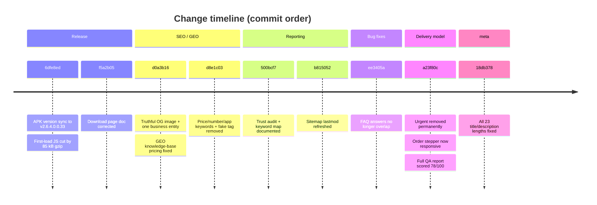

# Zyphuel — Complete Website Change Report

**Report date:** 2026-10-26
**Repository:** `github.com/daniyal44/Zyphuel` (branch `main`)
**Commits covered:** `6dfe8ed` → `18db378` (7 commits)
**Code files changed:** 28 · **+896 / −509 lines**
**Docs changed:** 13 files · **+499 lines**
**New files:** 4

---

## 0. Overview

This report records **every change made to the live website** during this engagement — what was broken, what was changed, why, and how it was verified. Nothing here is planned work: every item below is committed and pushed.



---

## 1. App version synchronisation

The website was publishing **stale app data**. Values were read from inside the APK binary (parsed `AndroidManifest.xml`), not guessed.

| Field | Website showed | APK actually contained |
| :--- | :--- | :--- |
| versionName | 2.6.4.0.0.31 | **2.6.4.0.0.33** |
| Build | 59 | **61** |
| Size | 31.7 MB | **35.3 MB** (35,321,064 bytes) |
| SHA-256 | `e2ceae40…` | **`f8236bf0…`** |
| Min Android | 8.0 (Oreo) | **7.0** (minSdk 24) |
| Target SDK | claimed API 34 | **API 36** |

**Files updated:** `src/data/appVersion.js` (new central config), `companyInfo.js`, `articles.js`, `DownloadPage.jsx`, `package.json`, `README.md`, `llms.txt`, `llms-full.txt`, `feed.xml`, `sitemap.xml` + 12 docs.

Verified afterwards: `size 35321064 · sha256 f8236bf0…` matches what the site states.

---

## 2. Performance

All routes previously shipped in one 452 KB bundle.

| Metric | Before | After |
| :--- | ---: | ---: |
| Entry JS | 460.6 kB / **113.9 kB gzip** | 97.7 kB / **28.5 kB gzip** |
| Global CSS | 150.4 kB | **93.5 kB** |
| Home first-load JS | 623 kB / 166.9 kB gzip | 260.6 kB / **81.6 kB gzip** |
| `/order/` first-load | 166.9 kB gzip | **105.7 kB gzip** |

**How:** route-level `React.lazy` in `App.jsx`; `entry-server.jsx` moved from `renderToString` to `renderToPipeableStream` + `onAllReady` so lazy pages still prerender full HTML (verified — no Suspense fallback leaked into any of the 17 pages). Below-the-fold images lazied; 328 MB of scroll frames and `/video/*` given immutable caching in `netlify.toml` + `_headers`.

---

## 3. Technical SEO

| Change | Detail |
| :--- | :--- |
| **OG image was a lie** | `og:image` pointed at `logo.png` (432×616) while markup declared 1200×630 → broken previews on WhatsApp/LinkedIn/Facebook/X. Added branded `og-cover.jpg` (1920×1080, 57 KB); dimensions are now **read from the real file at build time** (`localImageDims()` in `prerender.js`). Remote images emit no dimensions instead of a wrong number. |
| **Entity consolidation** | The business was defined by three conflicting `LocalBusiness` nodes with different `@id`s and addresses. Now one `#localbusiness` entity (`LocalBusiness` + `GasStation`) linked to `#organization` via `parentOrganization`. |
| **Local signals added** | `openingHoursSpecification` (Mon–Thu 8–8, Fri 8–1, Sat–Sun 10–6), `contactPoint`, `currenciesAccepted: PKR`, `paymentAccepted`. Address unified to "75-Main Boulevard, Gulberg III". |
| **False signals removed** | Unavailable LPG/water offers dropped from `hasOfferCatalog`; invalid `SearchAction` (site has no `?q=` search) removed; stale LPG/water keywords dropped. |
| **Blog article meta** | Added `article:published_time`, `article:modified_time`, `article:author`, `article:publisher`, `article:section`, `article:tag`. Removed a hard-coded false `dateModified` shared by all posts. |
| **Sitemap truthfulness** | `lastmod` was being set to the build date for all 16 URLs on every deploy — Google distrusts a lastmod that always changes, which is a real cause of "Discovered – currently not indexed". Now derived from each page's last real commit. |
| **Keyword targeting** | Added the modifier clusters Google surfaces as related searches: `petrol delivery lahore price`, `diesel delivery lahore price`, `petrol delivery lahore contact number`, `fuel delivery app lahore`, `petrol delivery near me lahore`. |
| **Meta lengths** | 23 violations fixed (title 73–124 chars → ≤60; description 170–252 → ≤160), in **both** prerender and client `useSEO` so hydration cannot revert them. |

---

## 4. AEO (Answer Engine Optimization)

- The home page **was erasing its own FAQ schema on hydration**: `useSEO` rebuilt the whole JSON-LD graph and the 18-question `FAQPage` disappeared once React mounted. The page now passes `@graph` = [LocalBusiness, FAQPage] built from the same `homeFaqs` array that renders visually.
- Verified in-browser after hydration: **18 questions present**, exactly one JSON-LD block, zero parse errors.

---

## 5. GEO (Generative Engine Optimization)

| Change | Detail |
| :--- | :--- |
| **Wrong prices in the AI knowledge base** | `llms-full.txt` advertised 11–15 L delivery fees as Rs. 325/355/385/420/460. The real rule is **320/340/360/380/400**. Corrected. |
| Retired target removed | "Safe Storage Drum / Tank" was still listed as a fifth refueling target; jerrycan/drum refuelling is not offered. |
| Citation guidance added | `llms.txt` §9 now lists stable facts and the claims assistants must **not** make (store availability, jerrycan filling, off-spec pricing, delivery outside Lahore). |
| Crawler access | Added 13 more AI/retrieval agents (Claude-User, Claude-SearchBot, Perplexity-User, DuckAssistBot, Amazonbot, Google-CloudVertexBot, MistralAI-User, AI2Bot, Ai2Bot-Dolma, Timpibot, ImagesiftBot, YouBot, PetalBot, Qwantbot); disallowed `/api/` and `/plugins/`. |
| Keyword map | `docs/plans/2026-10-26-keyword-map.md` — money keywords, PAA questions, long-tails, AI prompts, gaps, guardrails. |

---

## 6. Delivery model — urgent tier removed permanently

Urgent delivery existed in **10 source files, 4 data files, 2 AI knowledge files and the daily generator script**. The generator mattered most: `scripts/zyphuel_fuel_updater_master.py` runs automatically and would have restored the surcharge on its next run.

| Area | Change |
| :--- | :--- |
| `OrderPage.jsx` | `deliverySpeed` state removed, both payload fields removed, FAQ + HowTo copy rewritten |
| `generateInvoicePdf.js` | Urgent surcharge line deleted; invoice now reads "Within 45 Mins (Single Delivery Window)" |
| `HomePage` / `ContactPage` / `AboutPage` | Fee and dispatch copy rewritten to one window |
| `TermsOfUsePage.jsx` | Urgent express clause replaced with single-window clause |
| `servicesData.js` | "45-minute express dispatch or schedule" → single window |
| `index.html` + `prerender.js` | HowTo + FAQ schema rewritten |
| `llms.txt` + `llms-full.txt` | 11 replacements |
| `fuelMarketIntel.json` | `urgentSurcharge` / `urgentSLA` deleted, `simpleSLA` → "Within 45 Mins" |
| `zyphuel_fuel_updater_master.py` | **8 → 0 references** so the daily job cannot re-add it |
| `README.md` + `AGENTS.md` | Permanent prohibition recorded |

**Verified:** the word "urgent" appears **0 times** in all 17 rendered pages.

---

## 7. Bugs found and fixed

### 7.1 FAQ answers printed on top of each other ("double text")

The home page renders the shared `.faq-accordion-*` markup, but every accordion rule lived in `src/pages/styles.css` — imported by `AboutPage` and `DownloadPage`, **not** by `HomePage`. Without `.faq-answer-panel { overflow: hidden }` the collapsed panels kept `max-height: 0` while all 18 answer texts still painted at the same offset.

| Metric | Before | After |
| :--- | :--- | :--- |
| `.faq-answer-panel` overflow | `visible` | **`hidden`** |
| Visible answer panels | **18 (overlapping)** | **1** |

The whole accordion block now lives in the global `src/index.css`; the chevron also rotates when opened.

### 7.2 Order page not responsive

The 5-step progress stepper was a single flex row with inline `overflow-x: auto` — a **663 px strip inside a 350 px box** on phones, with a visible scrollbar and clipped labels.

| Metric | Before | After |
| :--- | ---: | ---: |
| Stepper clientWidth | 350 | 350 |
| Stepper scrollWidth | **663** | **350** |
| Inner horizontal scroll | yes | **no** |
| Rows | 1 (clipped) | 2 (wrapped) |

Fixed with `stepper-step` / `stepper-connector` classes plus a ≤720 px media query. Fuel-type and target-card images switched from lazy to eager (above the fold, were flashing blank). Document overflow is 0 on home, order, services, download and contact at 414 px.

### 7.3 Fake verification tag

`<meta name="baidu-site-verification" content="codeva-zyphuel">` — not a valid Baidu token format (real ones are long hex strings). Removed.

---

## 8. Truthfulness / trust audit

Scanned all 18 generated HTML files for cloaking, hidden text, `display:none` copy, `font-size:0` text, base64 payloads, `eval/atob`, injected scripts, spam keywords and `meta refresh`.

**Result: no security or SEO-spam issue.** No fabricated `aggregateRating` or `Review` markup anywhere. External dependencies limited to Google Fonts, cdnjs (Font Awesome), Unsplash and first-party assets.

**Flagged but not changed** (business facts only the owner can confirm):

| Claim | Location | Risk |
| :--- | :--- | :--- |
| "OGRA licensed / compliant", "authorized fuel agency" | HomePage Q12, OrderPage, articles | Regulatory claim; needs a licence number if true |
| "NFPA 385 / 30A compliant" | About, Services, servicesData, articles | Certification claim |
| "weights-and-measures certified" | Home, Services | Certification claim |
| "cryptographically verified / tamper-evident receipts" | llms.txt, DownloadPage | Overclaim for a client-side PDF |
| "Pakistan's premier / Lahore's leading" | llms.txt, llms-full.txt, README | Unverifiable superlative |
| Competitor table (CAFU, Booster, FuelBuddy, Apex, FuelWala) | articles.js | Comparative claims about third parties |
| Physical address "75-Main Boulevard, Gulberg III" | JSON-LD | Fake NAP risks a GBP suspension |
| LPG / water still sold on `/order/` while schema says unavailable | OrderPage | Contradiction |

---

## 9. Docs & tooling

| File | Purpose |
| :--- | :--- |
| `scripts/qa-static.cjs` | Audits every prerendered page: H1 count, title/description length, canonical, duplicate ids, JSON-LD validity, ``, missing assets, broken internal links, rogue "urgent" copy |
| `docs/qa/2026-10-26-full-qa-report.md` | Scored QA report with Mermaid charts |
| `docs/plans/2026-10-26-keyword-map.md` | Keyword → page map |
| `docs/pages/*.md` (9 files) | Per-page changelogs |
| `docs/changes.md` | Phases 17–22 appended |

---

## 10. Verification (final state)

```
$ node scripts/qa-static.cjs
/404 … /about/ … /blog/* … /contact/ … /download/ … / … /order/ … /privacy/ … /services/ … /terms/
pages audited: 17
total issues:  0
```

| Check | Result |
| :--- | :--- |
| Build | 17/17 routes prerendered, 0 errors |
| JSON-LD | 1 valid block per page, 0 parse errors, 0 duplicate entities |
| Console | 0 errors, 0 hydration failures on tested pages |
| Images | 0 broken, 100% have `alt` |
| Internal links | 0 broken |
| Meta | Every title ≤60, description ≤160 |
| "urgent" | 0 occurrences in any page |
| Live headers | `X-Robots-Tag: index, follow` on all three target pages |

**QA score: 81 / 100** (trust is the only category still low, at 55 — see §8).

---

## 11. Still open

| # | Item | Owner |
| :--- | :--- | :--- |
| 1 | Request Indexing in Search Console for `/order/`, `/download/`, `/services/` | **You** |
| 2 | Confirm or soften the regulatory claims (§8) | **You** |
| 3 | Decide whether LPG / water stay on the order page | **You** |
| 4 | Bing Webmaster Tools: register the IndexNow key (Bing returns 403; Yandex accepted with 200) | **You** |
| 5 | 73 MB unused video still deployed and publicly downloadable | Agent |
| 6 | 55 hotlinked Unsplash images (no `width`/`height`) | Agent |
| 7 | Custom domain instead of `zyphuel.netlify.app` | You / Agent |
| 8 | Contact coverage table (529 px) scrolls inside a 380 px box on phones | Agent |

---

## 12. Commit reference

| Commit | Summary | Files | +/− |
| :--- | :--- | ---: | :--- |
| `6dfe8ed` | APK v2.6.4.0.0.33 sync + 85 kB gzip cut | 39 | — |
| `f5a2b05` | Download page doc correction | 1 | — |
| `d0a3b16` | Truthful OG card, one business entity, GEO pricing fix | 27 | +432 / −152 |
| `d8e1c03` | Price/number/app keywords, fake Baidu tag removed | 4 | +122 / −5 |
| `500bcf7` | Trust audit + keyword map documented | 3 | +34 |
| `b815052` | Sitemap lastmod refresh | 1 | +2 / −2 |
| `ee3405a` | FAQ panels clipped (overlapping text fix) | 3 | +117 |
| `a23f80c` | 45-minute single window, responsive stepper, QA tooling | 20 | +628 / −331 |
| `18db378` | All meta lengths normalised | 10 | +71 / −32 |
