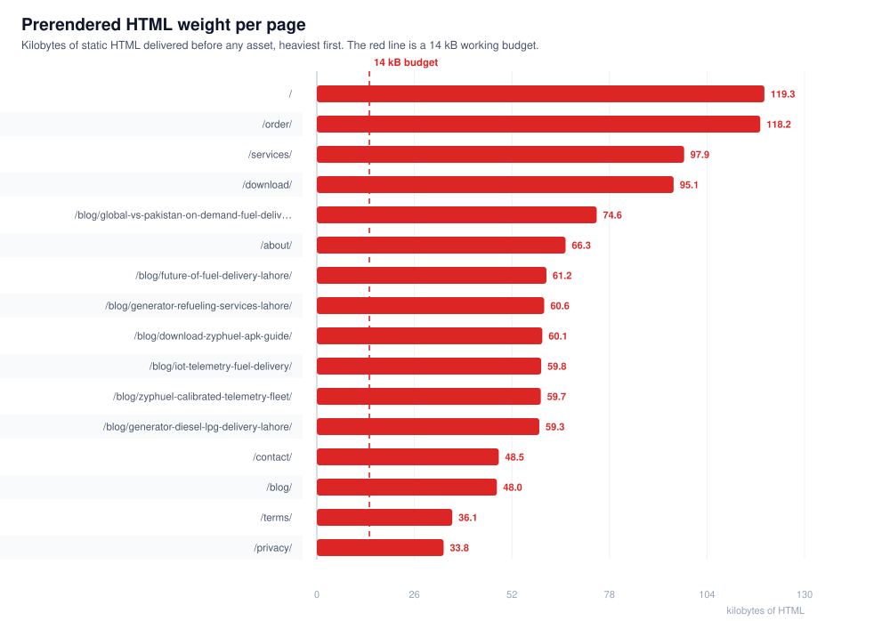
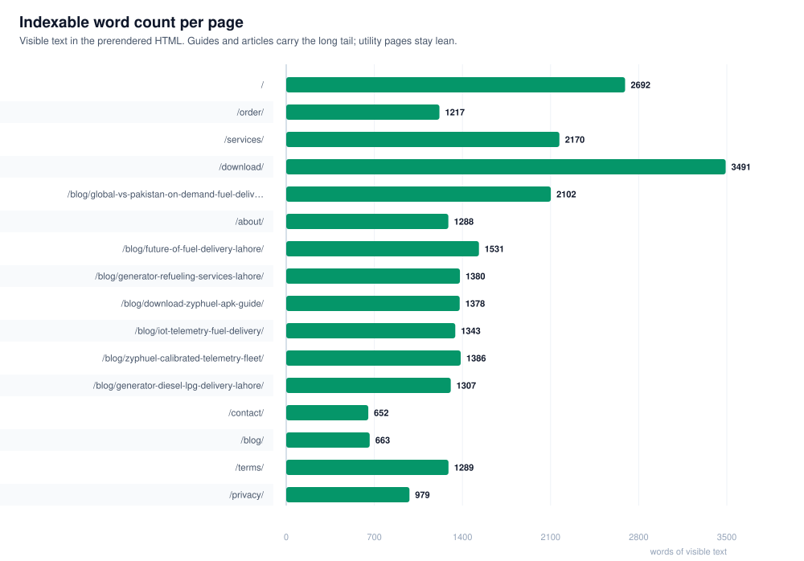
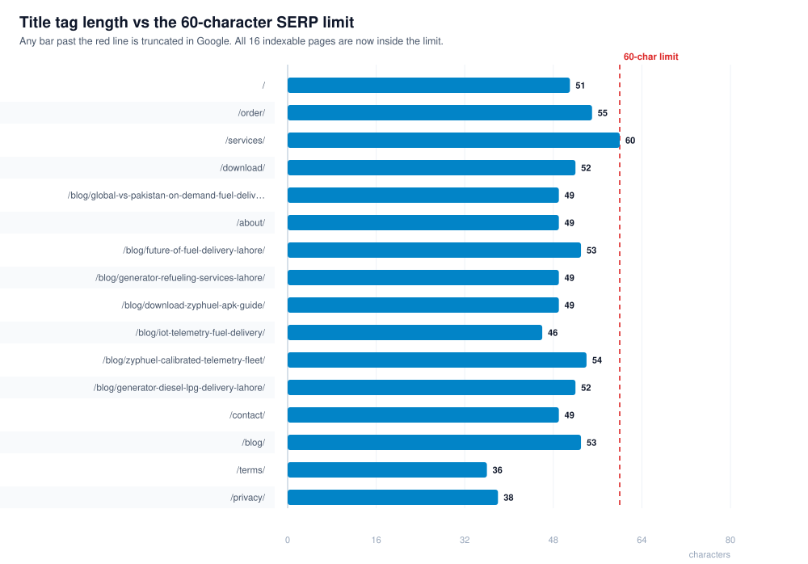
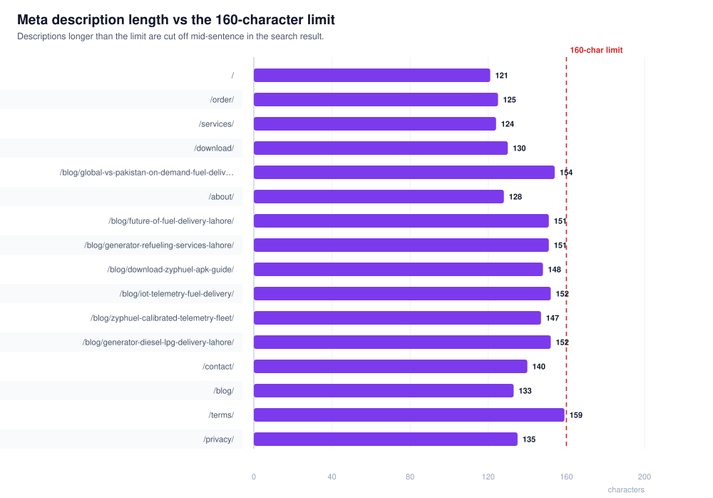
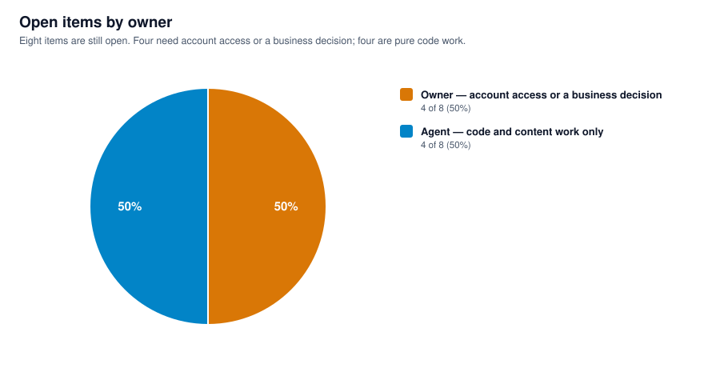

# Zyphuel — Whole Website Report

**Date:** 2026-10-26  
**Build measured:** `npm run build` → `dist/` (17 routes prerendered)  
**Data source:** `node scripts/report-stats.cjs` reading the built HTML — every number on this page comes from the build, not from memory.

> Charts on this page are committed SVG files under [`docs/reports/charts/`](./charts/). They are real images, so they display on GitHub, in the editor and in any browser.

---

## 1. At a glance

| Measure | Value |
| :--- | ---: |
| Routes served | **17** — 16 indexable + one `noindex` 404 |
| Total visible words | **25,129** (average 1,396 per page) |
| Total prerendered HTML | **1,124.7 kB** (average 62 kB per page) |
| Images in the HTML | **148** — **100%** carry `alt` text |
| Internal links | **693** |
| Pages with exactly one `H1` | **17 / 17** |
| Pages with valid JSON-LD | **17 / 17** |
| Titles over 60 characters | **0** |
| Descriptions over 160 characters | **0** |
| Sitemap URLs | **16** (the 404 is correctly excluded) |

---

## 2. Route inventory

| Route | What it is | Words | HTML |
| :--- | :--- | ---: | ---: |
| `/` | Home — hero, price calculator, sector grid, 18-question AEO hub | 2,692 | 119.3 kB |
| `/services/` | Fuel catalogue, commercial B2B, safety specifications | 2,170 | 97.9 kB |
| `/order/` | 5-step doorstep order flow, live pricing, invoice generation | 1,217 | 118.2 kB |
| `/download/` | Android APK v2.6.4.0.0.33 showcase, version history, install guide | 3,491 | 95.1 kB |
| `/about/` | Mission, founder profile, operating standards | 1,288 | 66.3 kB |
| `/contact/` | Enquiry form, helpline, coverage map | 652 | 48.5 kB |
| `/blog/` | Article index — 7 guides | 663 | 48.0 kB |
| `/blog/download-zyphuel-apk-guide/` | APK install walkthrough | 1,378 | 60.1 kB |
| `/blog/future-of-fuel-delivery-lahore/` | Market outlook | 1,531 | 61.2 kB |
| `/blog/generator-diesel-lpg-delivery-lahore/` | Generator fuel guide | 1,307 | 59.3 kB |
| `/blog/generator-refueling-services-lahore/` | Commercial refuelling | 1,380 | 60.6 kB |
| `/blog/global-vs-pakistan-on-demand-fuel-delivery-benchmarks/` | Competitor benchmarks | 2,102 | 74.6 kB |
| `/blog/iot-telemetry-fuel-delivery/` | Telemetry explainer | 1,343 | 59.8 kB |
| `/blog/zyphuel-calibrated-telemetry-fleet/` | Fleet metering | 1,386 | 59.7 kB |
| `/privacy/` | Privacy policy | 979 | 33.8 kB |
| `/terms/` | Terms of use | 1,289 | 36.1 kB |
| `/404/` | Not found — `noindex, follow` | 259 | 26.1 kB |

Two files in `dist/` are not customer pages and are excluded everywhere below: the `noindex` 404 above, and `google1ab7400cf65ca469.html`, a 0.1 kB Search Console verification stub with no title and no `H1`.

---

## 3. Page weight



`/` and `/order/` ship the most HTML (119.3 kB and 118.2 kB) because both embed the full AEO question set and their schema graphs. The red line is a 14 kB working budget and **no page meets it** — the weight is inline JSON-LD and markup, not text, so this is a known and accepted trade-off rather than an accident. The practical fix, if it is ever needed, is to move the FAQ answers out of the prerendered HTML and rebuild them on hydration.

---

## 4. Content depth



Depth is concentrated where the long-tail search demand is: `/download/` (3,491 words), `/` (2,692) and `/services/` (2,170). The two thinnest indexable pages are `/contact/` (652) and `/blog/` (663) — both are navigational, so thin content is defensible, but `/blog/` in particular has room to grow into a hub that explains each guide.

---

## 5. Title and description lengths





Every one of the 16 indexable pages now sits inside the 60-character title and 160-character description limits. Before commit `18db378`, 23 of these values were over the limit — blog titles ran 104–124 characters and descriptions up to 252, which means Google was cutting them mid-sentence in the result.

The fix had to be applied twice per page: once in `prerender.js` (what a crawler sees) and once in each page's `useSEO` props (what a browser sees after hydration). Fixing only the first reverts the moment React mounts.

---

## 6. Structured data coverage

| Route | Schema types emitted |
| :--- | :--- |
| `/` | WebSite, Organization, LocalBusiness, BreadcrumbList, FAQPage, Article, TechArticle |
| `/services/` | WebSite, Organization, LocalBusiness, BreadcrumbList, FAQPage, Article |
| `/order/` | WebSite, Organization, LocalBusiness, BreadcrumbList, **OrderAction**, **DeliveryService**, **HowTo**, FAQPage |
| `/download/` | WebSite, Organization, LocalBusiness, BreadcrumbList, **SoftwareApplication**, Article, FAQPage |
| `/about/` | WebSite, Organization, LocalBusiness, BreadcrumbList, **AboutPage**, FAQPage |
| `/contact/` | WebSite, Organization, LocalBusiness, BreadcrumbList, **ContactPage**, FAQPage |
| `/privacy/`, `/terms/` | WebSite, Organization, BreadcrumbList, WebPage |
| `/blog/` and 7 articles | WebSite, Organization, BreadcrumbList, Article or TechArticle, FAQPage |

17 of 17 pages parse cleanly with exactly one JSON-LD block. The business entity is a single `#localbusiness` node linked to `#organization` through `parentOrganization`, so no page contradicts another about the address, hours or phone number.

**Gap worth noting:** the `/blog/` index emits `Article` and `TechArticle` but no `Blog` or `CollectionPage` node, so it does not describe itself as a listing of the 7 articles it links to. Low impact, but it is the one schema gap on the site.

---

## 7. Indexing state

| Check | Result |
| :--- | :--- |
| `robots` meta on all indexable pages | `index, follow, max-image-preview:large, max-snippet:-1, max-video-preview:-1` |
| 404 meta | `noindex, follow` — correct |
| Self-canonical | 17 / 17 |
| In `sitemap.xml` | 16 / 16 indexable pages |
| Blocked in `robots.txt` | none of the 16 |
| AI crawler rules | 30+ agents allowed, `/api/` and `/plugins/` disallowed |
| `llms.txt` / `llms-full.txt` | present and factually corrected this round |

Technically nothing is stopping Google. The two pages that were not appearing in results — `/order/` and `/download/` — return 200, send `X-Robots-Tag: index, follow`, hold a self-canonical and appear in the sitemap. That is a crawl-queue problem, not a technical one, and the only lever is Search Console → URL Inspection → Request Indexing.

---

## 8. Feature inventory

Verified in the 2026-10-26 manual QA pass ([full report](../qa/2026-10-26-full-qa-report.md)); not re-tested for this document.

| Feature | State |
| :--- | :--- |
| 5-step order flow (fuel type → target → volume → address → contact) | Working |
| Volume rules — 5 L minimum, 15 L maximum, 1 L steps, chips at 5/7/10/12/15 | Working |
| Delivery fee — Rs. 300 up to 10 L, then +Rs. 20/L to Rs. 400 at 15 L | Working |
| Single delivery window: **within 45 minutes**, no priority tier | Working |
| Night cutoff 10:00 PM – 8:00 AM: submit button hidden, server guard returns 403 | Working |
| Invoice PDF — metered litres, QR/barcode, no urgent line | Working |
| WhatsApp dispatch link to `+92 3230-112464` | Working |
| Android APK direct download (`/APK/Zyphuel.apk`) | Working |
| Store badges disabled — "Launch Soon" / "Coming Soon", `pointer-events: none` | Correct |
| Blog index → article navigation, breadcrumbs | Working |
| Contact form (6 fields) + helpline + `tel:` links | Working |
| 404 page returns a real 404 with `noindex` | Working |

---

## 9. What is still wrong



| # | Issue | Severity | Who can close it |
| :--- | :--- | :--- | :--- |
| 1 | "OGRA licensed", "NFPA 385/30A compliant", "weights-and-measures certified", "cryptographically verified receipts" — none are verifiable from the site | **High** | Owner: publish the licence numbers, or the wording gets softened |
| 2 | `/order/` still sells LPG (Rs. 450/kg) and water (Rs. 100/gal) while the schema declares those services unavailable | **High** | Owner: a business decision |
| 3 | 73 MB of unused video and 328 MB of frame images are deployed and publicly downloadable | Medium | Agent |
| 4 | 55 hotlinked Unsplash images with no `width`/`height` — layout shift risk and a third-party dependency | Medium | Agent |
| 5 | No custom domain — everything hangs off `zyphuel.netlify.app` | Medium | Owner + Agent |
| 6 | `/order/` and `/download/` not yet indexed | Medium | Owner: Search Console |
| 7 | Contact page coverage table scrolls inside its box on phones | Low | Agent |
| 8 | `/blog/` index emits no `Blog`/`CollectionPage` schema | Low | Agent |

---

## 10. Reproducing this report

```bash
npm run build                      # vite build + SSR build + prerender 17 routes
node scripts/report-stats.cjs      # per-page facts -> scratch/report-stats.json
node scripts/make-report-charts.cjs # regenerates every SVG in docs/reports/charts/
```

`report-stats.cjs` prints the per-page table and writes the JSON that the four data charts read, so the numbers in the charts and the numbers in this document can never drift apart.
