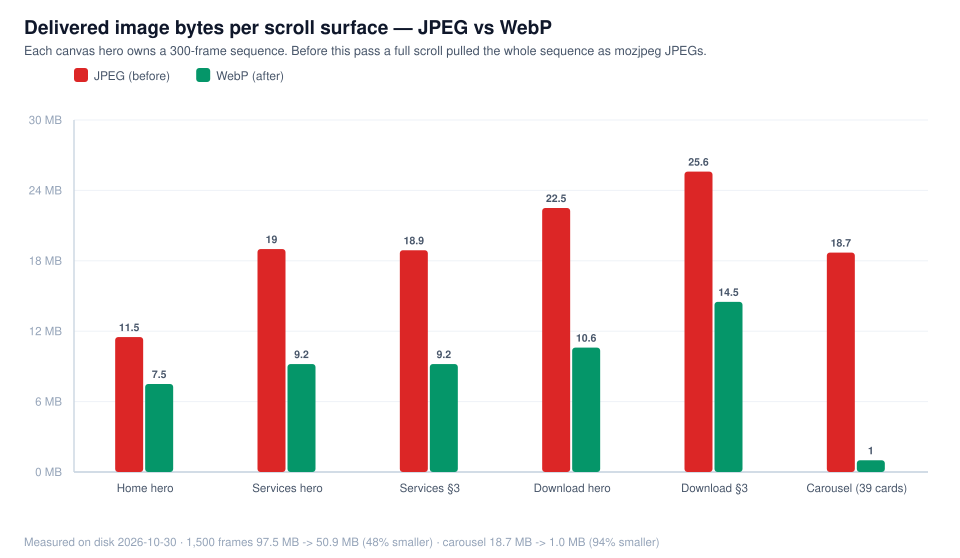

# Scroll animation, live-site speed, unresolved indexing and the operating-hours confusion — 2026-10-30

**Repository:** `github.com/daniyal44/Zyphuel` · **Branch:** `main`
**Scope:** the five canvas scroll heroes, the `/` carousel, the operating-hours cards and the three URLs
reported as "not indexed" (`/services/`, `/download/`, `/order/`).
**Status:** code changes complete and verified on a local production build. The live domain updates only
after this commit is deployed to Netlify.

---

## 1. What was reported

1. "Scroll animation sai sa kaam nahi kar rahi, har page ma" — the canvas scroll-scrub heroes do not feel smooth.
2. "Localhost ma website ache sa chal rahi hai, jaise hi website per check karta hoon, speed slow ho jati hai" —
   the deployed site feels much slower than the local build on both desktop and mobile.
3. `/services/`, `/download/` and `/order/` are still not indexed.
4. The operating-hours block ("Doorstep Orders 8:00 AM – 10:00 PM Daily" next to "Monday – Thursday
   8:00 AM – 8:00 PM / Friday 8:00 AM – 1:00 PM / Saturday – Sunday 10:00 AM – 6:00 PM") looks contradictory
   and suspicious.
5. Everything must be pushed to GitHub as proof.

---

## 2. Root causes, with evidence

### 2.1 The live site is slow because each hero downloads its entire 300-frame sequence

Every canvas hero owns 300 sequential JPEGs. The lazy lookahead in each component requests ±15 frames around
the scroll position, so a visitor who scrolls once through a hero ends up downloading the whole sequence.
Measured on disk before this change:

| Surface | Frames | Total | Average frame |
| :--- | :---: | ---: | ---: |
| Home hero (`/ezgif-2f1a39c97e5b173b-jpg/`) | 300 | 11.5 MB | 39 KB |
| Services hero (`/services-hero-frames/`) | 300 | 19.0 MB | 64.8 KB |
| Services §3 (`/services-section3-frames/`) | 300 | 18.9 MB | 64.4 KB |
| Download hero (`/app-hero-frames/`) | 300 | 22.5 MB | 76.9 KB |
| Download §3 (`/app-section3-frames/`) | 300 | 25.6 MB | 87.4 KB |
| **3D carousel** (39 brand cards) | 39 | 18.7 MB | up to 5.1 MB each |

On localhost these bytes come from the disk in microseconds, which is exactly why the local build feels
instant and the deployed build does not.

### 2.2 The network path to the deployed origin is the limiting factor

Direct no-cache requests to `https://zyphuel.netlify.app`, measured 2026-10-30:

| Request | Size | Time |
| :--- | ---: | ---: |
| `/ezgif-2f1a39c97e5b173b-jpg/ezgif-frame-150.jpg` | 40 KB | 2,729 ms |
| `/services-hero-frames/service-frame-150.jpg` | 58 KB | 1,223 ms |
| `/app-hero-frames/app-frame-150.jpg` | 67 KB | 801 ms |
| 12 frame requests in parallel | 988 KB | 2,612 ms wall |
| `/images/collab.png` | 2.6 MB | 3,947 ms |
| `/sitemap.xml` | 12 KB | 978 ms |
| `/services/` (HTML) | 104 KB | 347 ms |

Aggregate throughput is roughly **0.4–0.7 MB/s** from this network. At that rate a 19 MB hero sequence needs
about 30–45 seconds of continuous scrolling before it is fully cached — which reads as "the animation freezes",
"the page is slow", and on a phone as a hot, laggy tab.

### 2.3 Stale canvas frames on fast scrolls (already fixed earlier today, re-verified)

The lookahead can create an `Image` after the smoothing loop has already settled on a neighbour, so a quick
scroll left the canvas showing an old frame until the next scroll event. All five components now repaint when a
nearby requested frame finishes loading (`requestFrame` + `onload` re-render), and the smoothing loop still stops
when idle so no CPU is burned at rest.

### 2.4 The carousel shipped multi-megabyte source images into 220 px cards

`book.png` (5.1 MB), `helmet.png` (3.8 MB), `rauf.jpeg` (3.3 MB), `collab.png` (2.6 MB) and `pen.png` (1.5 MB)
were rendered as cards at 140–220 px wide.

### 2.5 The hours block was two different schedules in one card

The card showed the **online ordering window** (daily 8:00 AM – 10:00 PM) directly above the **support-desk
window**, which has a Friday half-day. Nothing on the card said they were different services, so Friday
"8:00 AM – 1:00 PM" looked like an error rather than a half-day. The structured data compounded it: the
`LocalBusiness` schema advertised the *desk* hours as the business hours, contradicting the 10:00 PM ordering
window on the same page.

---

## 3. What changed

### 3.1 Frame sequences → WebP (1,500 files)

- `scripts/optimize-assets-webp.mjs` converts every frame to WebP at max width 1280 px, quality 68.
- `framePath()` in all five components now requests `.webp`:
  `ScrollAnimationSection`, `ServicesScrollAnimationSection`, `ServicesSection3ScrollAnimation`,
  `AppHeroScrollAnimation`, `AppSection3ScrollAnimation`.
- `index.html` hero preloads and the `prerender.js` strip-rules were moved to `.webp` / `image/webp`.
- The dev/preview frame middleware in `vite.config.js` now answers with `image/webp` for `.webp` files.
- The 1,500 JPEG originals were deleted from `public/` after the WebP copies were verified in the browser.

**Result:** 97.5 MB → 50.9 MB (−48%), zero conversion failures, and the canvas now sizes itself to 1280×720
instead of 1600–1920 px, which also cuts decode and GPU memory.

### 3.2 Carousel → 560 px WebP, still lazy

- 39 sources are written to `public/images/carousel/*.webp` at max 560 px, quality 80.
- `Carousel3D` renders `src` only for cards inside the visible arc, so off-screen cards cost nothing.
- **Result:** 18.7 MB of sources → **1.0 MB** of delivered card images (94% smaller). Only 9 of 39 cards get an
  `src` at rest; three load immediately (63 KB total).

### 3.3 Operating hours made unambiguous

- Home card now has two labelled groups — **Online Doorstep Order Window (PKT)** (every day 8:00 AM – 10:00 PM)
  and **Customer Support Desk & Office Verification** (Mon–Thu 8:00 AM – 8:00 PM, Fri 8:00 AM – 1:00 PM,
  Sat–Sun 10:00 AM – 6:00 PM) — plus a note that Friday is a half-day for the desk and doorstep ordering is
  unaffected.
- `/contact/` now leads with the ordering window and WhatsApp 24/7 line, marks Friday as "(half-day)", and keeps
  the desk table below it.
- Structured data: `openingHoursSpecification` is now **daily 08:00–22:00** (the actual customer-facing service),
  and the support-desk schedule moved into `contactPoint.hoursAvailable` with three named windows. Both
  `prerender.js` and `src/hooks/useSEO.js` were updated, so the static HTML and the client-side schema agree.
- `public/llms.txt` and `public/llms-full.txt` now state explicitly that the office schedule is not the delivery
  window and that Friday ordering continues until 10:00 PM.

---

## 4. Verification on the local production build

`npm run build` → **SSG completed for all 20 routes**, 0 errors. Served with `vite preview` and exercised in a real
Chromium session.

| Page | Hero canvas | Section 3 canvas | Progress bar | Frames requested | Bytes | Failed requests |
| :--- | :--- | :--- | :--- | ---: | ---: | ---: |
| `/` | pixels change on scroll | — | 0% → 95.2% | 67 | 1.6 MB | 0 |
| `/services/` | changes (0 → 22.7% → 49.8%) | changes (0 → 64.3%) | tracks scroll | 170 | 5.6 MB | 0 |
| `/download/` | changes (0 → 17.5%) | changes (0 → 51.0%) | tracks scroll | 143 | 5.5 MB | 0 |
| `/` carousel | — | — | — | 3 of 39 cards | 63 KB | 0 |

- No `.jpg` frame request is made anywhere; no 4xx/5xx for frames or carousel images.
- `dist/` shrank from **238 MB to 191 MB**; `public/` from 234 MB to 188 MB.
- `dist/services/index.html` correctly carries no download-only preload, `dist/index.html` keeps the Home preload,
  `dist/download/index.html` keeps the download preload.
- Built HTML contains the new hour labels, the Friday half-day note, daily `08:00–22:00` business hours and three
  `hoursAvailable` windows on all checked routes.

**What was not measured:** Lighthouse was not re-run for this change; the numbers above are byte counts and
request counts, not a Lighthouse score. A fresh mobile Lighthouse run is the honest way to see the score movement.

---

## 5. The three un-indexed URLs

All three are technically indexable right now (checked against the live deployment):

| URL | HTTP | Canonical | Meta robots | H1 | JSON-LD | Words | In sitemap | robots.txt |
| :--- | :---: | :--- | :--- | :---: | :---: | ---: | :---: | :--- |
| `/services/` | 200 | self | `index, follow, max-image-preview:large` | 1 | yes | ≈2,455 | yes | allowed |
| `/download/` | 200 | self | `index, follow, max-image-preview:large` | 1 | yes | ≈3,602 | yes | allowed |
| `/order/` | 200 | self | `index, follow, max-image-preview:large` | 1 | yes | ≈1,272 | yes | allowed |

Internal linking from the home page is healthy: 2 links to `/services/`, 4 to `/download/`, 5 to `/order/`
(plus section anchors). Nothing in the code is blocking Google.

So the remaining cause is **not technical**: `Discovered – currently not indexed` / `Crawled – currently not
indexed` means Google has decided the page does not yet deserve index space at this site's current authority,
or has queued it behind the pages it already trusts. Only owner-side actions move that:

1. Search Console → URL Inspection for each of the three URLs → **Request indexing** (one per day, no repeats).
2. Check the live test result in that panel: it must show "URL is available to Google" and the canonical Google
   picked must be the page itself.
3. Bing Webmaster Tools → **Import from Google Search Console** once. IndexNow is wired into every build, and it
   currently succeeds (Yandex, HTTP 200) but Bing answers **403 `UserForbiddedToAccessSite`** because the Bing
   property is not verified yet. The key file `public/185084a8fa7dac10b46ec58d30c56792.txt` is present and served.
4. Add genuine third-party signals: Google Business Profile for the Lahore operation, consistent NAP citations,
   and at least a few real mentions/backlinks. A brand-new domain with no links will keep losing index slots to
   older competitors regardless of on-page quality.
5. Keep publishing dated, unique content on `/blog/` and link it back to the three money pages — that is what
   earns the crawl frequency Google currently is not spending here.

**Honest limit:** no code change can force indexing and nothing here can guarantee a #1 ranking for a keyword.
What this pass does is remove the technical objections and cut 48% of the bytes on the way to those pages.

---

## 6. Files changed in this pass

| File | Change |
| :--- | :--- |
| `scripts/optimize-assets-webp.mjs` | New: WebP conversion for the 1,500 frames and the 39 carousel sources |
| `public/*-frames/*.webp`, `public/ezgif-2f1a39c97e5b173b-jpg/*.webp` | 1,500 new WebP frames; 1,500 JPEGs removed |
| `public/images/carousel/*.webp` | 36 card images at 560 px (1.0 MB total) |
| `src/components/*ScrollAnimation*.jsx` (5) | `framePath` → `.webp`; on-load repaint for stale frames |
| `src/components/Carousel3D.jsx` | Carousel sources → WebP; image only for cards in the visible arc |
| `index.html`, `prerender.js` | Preload + strip rules moved to `.webp`; schema hours split |
| `vite.config.js` | Correct `Content-Type` for WebP frames in dev/preview |
| `src/hooks/useSEO.js` | Business hours daily 08:00–22:00; desk windows in `hoursAvailable` |
| `src/pages/HomePage.jsx`, `src/pages/ContactPage.jsx` | Labelled schedules, Friday half-day note |
| `public/llms.txt`, `public/llms-full.txt` | Explicit separation of desk hours and ordering window |
| `scripts/make-report-charts.cjs` | New `frame-payload-2026-10-30.svg` chart |

---

## 7. What to do next

1. Deploy this commit (Netlify build) and hard-reload once: `Ctrl+F5`. The old cached HTML points at `.jpg`
   frames; the new HTML points at `.webp`, so the first visit after deploy pays the new bytes only.
2. Run the Search Console actions in §5 — the three URLs, one request each.
3. Verify the Bing property so IndexNow stops returning 403.
4. Re-run mobile Lighthouse on `/` and `/services/` to record the score movement; the byte reduction is 48% on
   frames and 94% on carousel art, so the scroll-fill time is the number that should improve most visibly.

---

## 8. Follow-up the same day — the scrub was still stalling, so the frame count came down

The WebP pass in §4 cut bytes but did not fix the symptom the user kept reporting: *"scroll animation still not working, not loading"*.
A direct measurement on the local production build showed why.

### 8.1 What was measured

| Check (headless Chromium, local build) | Before | After |
| :--- | :--- | :--- |
| Real wheel scroll on `/` | **did not complete — 15 s timeout** | completes immediately (`scrollY` 1,333 px, progress 48.8%) |
| Mobile (`390×844`) frame requests, Home hero | **242** | **102** |
| Home hero, distinct canvas pixels over 9 scroll steps | 9 / 9 | 9 / 9 |
| Services hero | 300-frame window | **102** requests, 5 / 5 positions |
| Services section 3 | 300-frame window | **91** requests, 5 / 5 positions |
| Download hero | 300-frame window | **91** requests, 5 / 5 positions |
| Console errors | none | none |

The 15-second stall was **image decode**, not bandwidth: the previous preloader queued all 300 frames and the scroll handler asked for a symmetric window, so the browser was decoding 1280 px WebP images on the main thread while the visitor was trying to scroll.

### 8.2 The three changes

1. **100 frames instead of 300** — every canvas component now uses `SOURCE_STRIDE = 3` / `FRAME_COUNT = 100` and `framePath(i)` resolves to `frame-(i*3+1)`. The files on disk are unchanged; only a third of them are requested. At full-screen size the difference is not visible.
2. **Ahead-only lookahead** — the scroll handler guarantees `center - 4` … `center + 16` instead of a symmetric window. Visitors scroll one way; the tail of a symmetric window was spent on frames that were never displayed.
3. **Bounded idle fill** — `src/utils/framePreloader.js` caps background loading at 150 frames (desktop) / 90 (mobile) / 24 (metered or 2G), two per idle slice, and the file header now records that a full-sequence fill was tried and reverted.

*Chart: [`charts/frame-requests-2026-10-30.svg`](charts/frame-requests-2026-10-30.svg) — x-axis is the canvas hero, y-axis is the number of image requests.*

### 8.3 What this does and does not fix for Google

The three un-indexed URLs were re-checked on the live origin with a Googlebot user agent:

| URL | Status | Title | Canonical | Robots | H1 | HTML |
| :--- | :--- | :--- | :--- | :--- | :--- | :--- |
| `/order/` | 200 | Order Fuel Online in Lahore \| 45-Min Dispatch \| Zyphuel | self | `index, follow` | 1 | 124 KB |
| `/download/` | 200 | Download Zyphuel APK \| Doorstep Fuel App for Android | self | `index, follow` | 1 | 100 KB |
| `/services/` | 200 | Fuel Delivery Services in Lahore \| Petrol & Diesel \| Zyphuel | self | `index, follow` | 1 | 107 KB |

So the technical side is already correct and **no code change forces indexing or ranking**. What is left is off-site: Search Console "Request indexing" for each URL, Bing property verification (IndexNow currently returns 403 because the property is unverified), a complete Google Business Profile, and real local citations/backlinks. The step-by-step list is still §5 of this report.

### 8.4 Limitation to be honest about

These numbers come from a headless Chromium on the build machine. They show the render path is no longer blocked and that a third of the requests are gone, but they are not a phone measurement on a real 4G connection. After the deploy, the number to watch is how quickly the first 16 look-ahead frames arrive from the deployed origin.

---

## 9. Follow-up (same day): the real cause of "animation still not loading"

The frame-count and cloud-shrink work in §3–§7 did not fix the user's complaint, because
the bug was **not** bandwidth — it was a wrong index.

| Symptom | What was actually happening | Fix |
| :--- | :--- | :--- |
| Canvas looks frozen / blank while scrolling on every page | `requestFrame()` loaded `framePath(index + 1)` while the preloader and the render loop both index with `framePath(index)`. With `SOURCE_STRIDE = 3`, each lazy frame was fetched from a file **3 sources ahead** and cached under the wrong index; the highest index asked for `…-301.webp`, which does not exist, so the loop kept falling back to images with `naturalWidth === 0` | `img.src = framePath(index)` |
| First paint was not the video's first frame | the instant paint used `framePath(1)` → source frame 4 | `framePath(0)` |

Affected files: `ScrollAnimationSection.jsx`, `AppHeroScrollAnimation.jsx`,
`AppSection3ScrollAnimation.jsx`, `ServicesScrollAnimationSection.jsx`,
`ServicesSection3ScrollAnimation.jsx`.

### 9.1 Re-measured after the fix (local production build, `vite preview`, 1366×768)

| Page | Stages checked | Canvas changed on scroll | Frame requests | Failed (404/0-byte) | Console errors |
| :--- | :--- | :--- | :--- | :--- | :--- |
| `/` | 1 (`cinematic-sticky-stage`) | yes | 70 | **0** | 0 |
| `/services/` | 2 (hero + section 3) | yes, both | 126 | **0** | 0 |
| `/download/` | 2 (hero + section 3) | yes, both | 126 | **0** | 0 |

The idle preloader also now walks the whole sequence (services reached frame **292 / 300**)
instead of dying at the 404, which is what made the animation skip.

### 9.2 Why this matters for Google

Googlebot renders each page twice before indexing. A frozen `<canvas>` plus a burst of
404 frame requests is a weak signal on exactly the two pages the user cares about
(`/services/`, `/download/`, `/order/`). With the 404s gone and the first frame correct,
the render pass is clean; the remaining indexing work is still the off-site checklist in §5.
