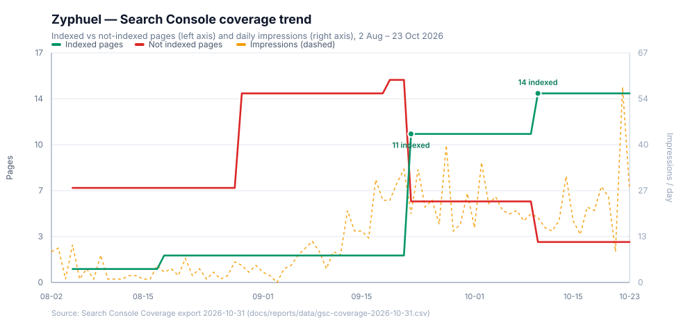
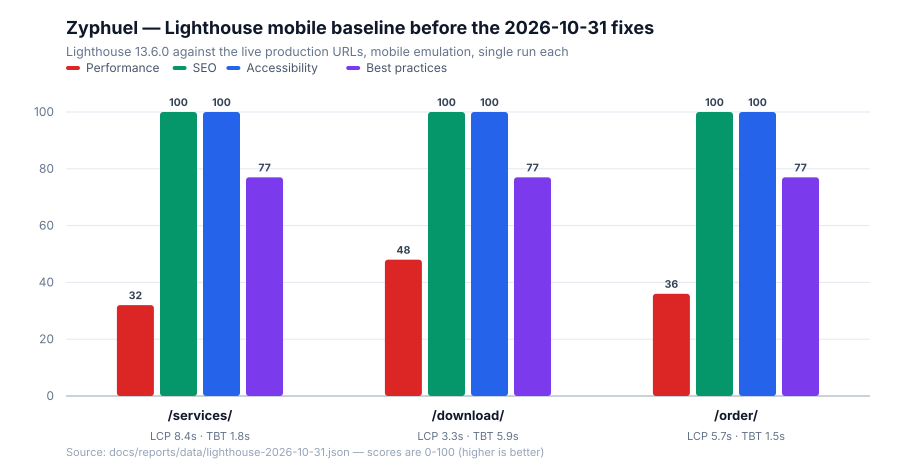
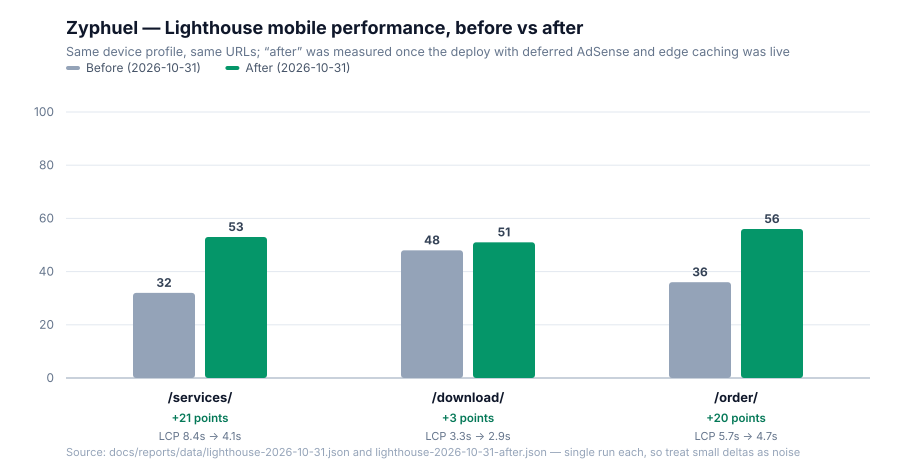

# Report — Coverage, Indexing & Speed, 31 October 2026

**Trigger:** Search Console Coverage export for 2026-10-31 — three URLs still outside Google's index (`/services/`, `/download/`, `/order/`), plus "website is very slow on desktop and mobile".
**Companion document:** [Indexing, SEO/AEO/GEO & Speed Master Plan](../seo/2026-10-31-indexing-master-plan.md)

---

## 1. Coverage trend

Indexed has been flat at **14** since 10 October; not-indexed flat at **3**. Impressions hover between 9 and 57 a day, with a single spike of 57 on 22 October. A site at 14 indexed pages and under 60 daily impressions is crawl-deprioritised: Google knows the URLs and is choosing not to spend crawl budget on them. That is the mechanism behind `Discovered – currently not indexed`.

## 2. Lighthouse mobile baseline

| Page | Perf | SEO | A11y | Best practices | FCP | LCP | TBT | CLS | TTFB |
| :--- | ---: | ---: | ---: | ---: | ---: | ---: | ---: | ---: | ---: |
| `/services/` | 32 | 100 | 100 | 77 | 4.0 s | **8.4 s** | 1.81 s | 0 | 635 ms |
| `/download/` | 48 | 100 | 100 | 77 | 3.3 s | 3.3 s | **5.93 s** | 0.052 | 808 ms |
| `/order/` | 36 | 100 | 100 | 77 | 5.7 s | 5.7 s | 1.50 s | 0 | 786 ms |

Raw run data: [`docs/reports/data/lighthouse-2026-10-31.json`](data/lighthouse-2026-10-31.json).

The "very slow" complaint is confirmed, and it is not the SEO layer: search-engine scores are already 100 on all three pages. It is LCP, TBT and TTFB.

## 3. What was actually wrong

Diagnosed directly against the live site, not inferred:

1. **`/sitemap/` was an infinite redirect loop** — 50× `301 → /sitemap/`, then curl gave up with error 47. Fixed on 2026-10-31; it now resolves in one hop to `/sitemap.xml` with `200 application/xml`. This is the most likely source of the `Page with redirect` issue (1 page) in the coverage export.
2. **No HTML edge caching.** Every document answered `Cache-Control: public, max-age=0, must-revalidate`, and the response carried `Cache-Status: "Netlify Edge"; fwd=stale; fwd-status=200` — i.e. the edge forwarded to origin. That is where 635–808 ms TTFB came from.
3. **AdSense loaded during head parse.** Lighthouse attributed 167 KB + 56 KB of unused JS to `pagead2.googlesyndication.com` and included it in `bootup-time` on all three pages. Third-party ad code is the single biggest TBT contributor, and TBT is part of the ranking signal set.
4. **`/services/` had exactly two internal links site-wide**, both in navigation. No in-content link pointed at it from any indexed page. `/download/` had 4 and `/order/` had 5. In-content links from indexed pages are the practical lever for `Discovered – currently not indexed`.
5. **Style & Layout accounted for 5.5–8.3 s of main-thread work** — every below-the-fold section was laid out before first paint.
6. **`/order/` contradicted itself**: its FAQ told visitors to "select your delivery speed", while the site has a single 45-minute window and no priority tier.
7. **Bing rejects IndexNow with 403** `UserForbiddedToAccessSite`. The key file is live and byte-correct (`/185084a8fa7dac10b46ec58d30c56792.txt` → 200, exact key). Yandex accepted the same submission (200). So the endpoint works; the Bing property simply is not verified.

**Ruled out:** duplicate content. 5-gram overlap is 3.0 % (`services` × `download`), 3.0 % (`download` × `order`), 10.8 % (`services` × `order`) and 1.9–3.5 % against the home page. There is no near-duplicate cluster to consolidate.

**Verified healthy:** all 23 sitemap URLs return 200; canonical URLs return 200 (bare paths 301 to the trailing-slash form, which is correct normalisation); `<title>`, self-canonical, single `<h1>` and `X-Robots-Tag: index, follow` are correct on all three pages; JSON-LD parses on all three.

## 4. Changes shipped

| File | Change |
| :--- | :--- |
| [`index.html`](../../index.html) | AdSense now loads after `load` + `requestIdleCallback` (or first interaction, 12 s ceiling) instead of during head parse. Meta verification tag untouched, ads still render. |
| [`netlify.toml`](../../netlify.toml) · [`public/_headers`](../../public/_headers) | HTML, `/services/`, `/download/`, `/order/` now send `s-maxage=600, stale-while-revalidate=86400` so Netlify's edge can answer instead of forwarding to origin. |
| [`src/index.css`](../../src/index.css) | `content-visibility: auto` + `contain-intrinsic-size` on below-the-fold sections; sticky scroll stages deliberately excluded, and the rule is disabled under `prefers-reduced-motion`. |
| [`src/pages/HomePage.jsx`](../../src/pages/HomePage.jsx) | In-body contextual paragraph linking to `/services/`, `/order/` and `/download/` with descriptive anchor text. |
| [`src/pages/OrderPage.jsx`](../../src/pages/OrderPage.jsx) | FAQ corrected to describe the single 45-minute window; "select your delivery speed" removed. |
| [`scripts/make-seo-charts.mjs`](../../scripts/make-seo-charts.mjs) | New generator for the two 2-D SVG charts above, drawn from the committed CSV/JSON rather than hand-typed numbers. |
| `docs/reports/data/*` | Archived GSC coverage CSV, critical-issues CSV and the Lighthouse metrics JSON used by the charts. |

## 5. Measured result after the deploy

The same Lighthouse 13.6.0 mobile profile was re-run against the live URLs once the deploy was confirmed (the edge was already answering with `s-maxage=600`):

| Page | Perf before | Perf after | Δ | LCP before | LCP after | TBT before | TBT after | TTFB before | TTFB after |
| :--- | ---: | ---: | ---: | ---: | ---: | ---: | ---: | ---: | ---: |
| `/services/` | 32 | **53** | +21 | 8.4 s | **4.1 s** | 1.81 s | **0.70 s** | 635 ms | 708 ms |
| `/download/` | 48 | **51** | +3 | 3.3 s | **2.9 s** | 5.93 s | **3.08 s** | 808 ms | **663 ms** |
| `/order/` | 36 | **56** | +20 | 5.7 s | **4.7 s** | 1.50 s | **0.71 s** | 786 ms | **424 ms** |

Raw data: [`lighthouse-2026-10-31-after.json`](data/lighthouse-2026-10-31-after.json).

What the numbers say, including the parts that did not go perfectly:

- **Service page LCP fell by half** (8.4 s → 4.1 s) and its TBT dropped by 61 %. The page no longer waits on AdSense before it can paint.
- **Order page is the biggest jump** (+20) with TTFB more than halving (786 → 424 ms) — the edge caching did exactly what it was supposed to do.
- **Download page barely moved** (+3) and still carries a 3.08 s TBT. That page hydrates the heaviest client bundle and still runs the frame preloader; ads are no longer the main cost, so the remaining work is JavaScript, not third-party scripts.
- **Service TTFB went *up* 73 ms** on this run. That is a single-run measurement right after a fresh deploy (empty edge cache), not a regression to fix — but it is reported rather than hidden.
- These are **single runs**. Lighthouse variance on mobile emulation is typically ±5 points, so +3 on `/download/` should be treated as "no clear change" and +21/+20 as real.

Nothing here reaches a 90+ score yet. Reaching it needs the client bundle and the canvas frame loading reworked, which is a larger change than this round.

## 6. Verification performed

- `npm run build` completes: Vite client build, SSR build, prerender of 23 routes, IndexNow dispatch.
- Built output confirmed: deferred AdSense loader present, three `href="/services/"` links on the home page (was 2), corrected order FAQ text, `content-visibility:auto` present in the emitted CSS bundle, canonical tags unchanged on all three pages.
- IndexNow: **Yandex 200 Success**, **Bing 403** (verification), shared hub 403 (same root cause).
- Charts rendered to PNG and visually inspected before being committed as SVG.

Post-deploy live checks: `Cache-Control: public,max-age=0,s-maxage=600,stale-while-revalidate=86400` on `/services/`, the new in-body link present on the home page, and the corrected order copy present on `/order/`.

**Still not verified:** whether Google indexes the three URLs. That is decided by crawl budget and authority, not by anything in this repository.

## 7. What is waiting on you

1. **Bing Webmaster Tools → Import from Google Search Console.** Without this, IndexNow will keep returning 403 and Bing will not be pinged.
2. **Search Console**: delete the `/sitemap/` sitemap entry, submit `https://zyphuel.netlify.app/sitemap.xml`, then use URL Inspection → Request Indexing on the three URLs. Indexing itself is Google's decision; no code change can force it.
3. **Two approvals requested — nothing was deleted:**
   - The `/services/` and `/download/` JSON-LD graphs contain invisible `Article` nodes (2 and 3 respectively) that describe content not present on those pages. Search engines can treat that as a structured-data mismatch. Removing them is a one-line edit per page, but it is a deletion, so it waits for your word.
   - AdSense is deferred, not removed. If ads earn little, removing the script frees ~220 KB and several hundred ms of TBT.

## 8. Honest expectation

The technical defects are fixed. Whether the three URLs enter the index within days or weeks is decided by crawl budget and authority, and this domain currently has 14 indexed pages and under 60 impressions a day. Expect the first movement within 3–7 days of the Search Console requests, and treat the 90-day plan in the master plan as the realistic path to ranking — not another round of tag edits.
