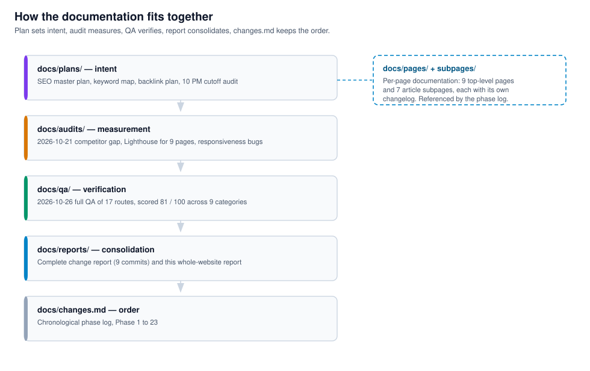
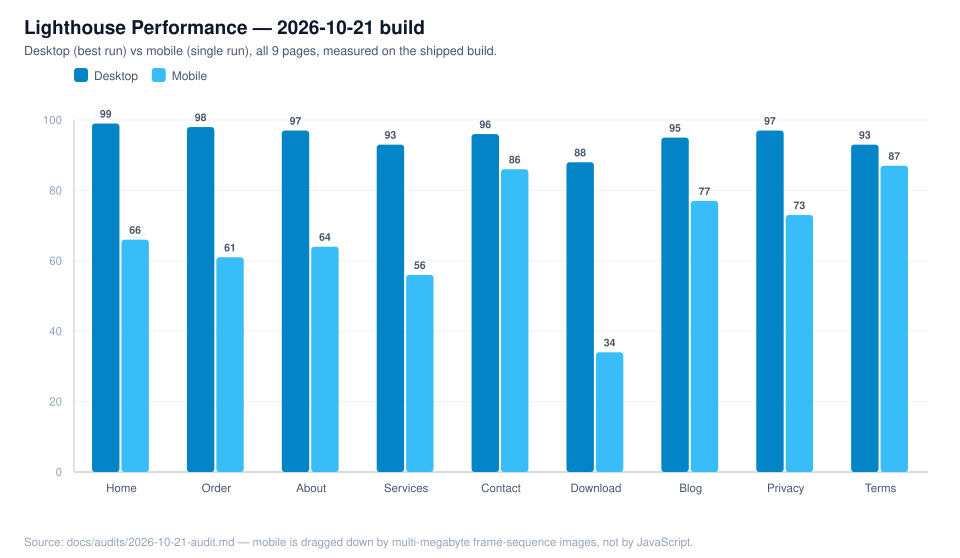
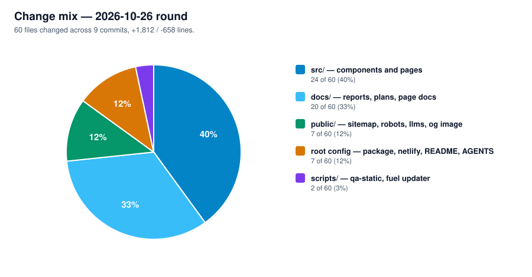
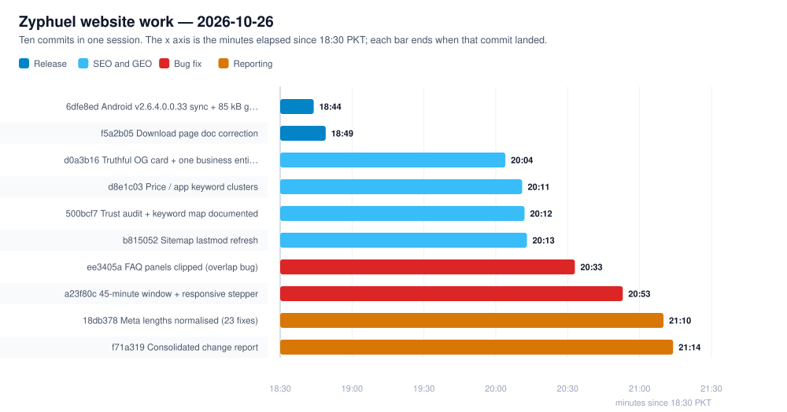

# Zyphuel — Reports Hub

**Last updated:** 2026-10-28  
**Repository:** `github.com/daniyal44/Zyphuel` (branch `main`)

This is the single entry point for every audit, QA pass and change report on the Zyphuel website. Each report below is committed and pushed; the graphs in this file are rendered from the same numbers the reports themselves contain.

> Every chart on this page is a committed SVG file under [`charts/`](./charts/), generated by `node scripts/make-report-charts.cjs`. They are real images, so they display on GitHub, in the editor and in a plain browser — no renderer, extension or internet connection is needed.

---

## 1. How the documentation fits together



| Stage | Folder | Question it answers |
| :--- | :--- | :--- |
| Plan | `docs/plans/` | What did we set out to do? |
| Audit | `docs/audits/` | What was measured, and how bad was it? |
| QA | `docs/qa/` | Did it actually work after the change? |
| Report | `docs/reports/` | What changed, by how much, and on whose authority? |
| Log | `docs/changes.md` | In what order did the whole project happen? |

---

## 2. Every report in the repository

| Date | Report | Type | Score / Headline | File |
| :--- | :--- | :--- | :--- | :--- |
| **2026-10-28** | **Search Console Indexing & Visibility Report** — read from the owner's Coverage + Performance exports | Report | 14 indexed / 3 not · 1 click / 17 impressions (question-filtered) · 5 code fixes | [`docs/reports/2026-10-28-search-console-indexing-report.md`](./2026-10-28-search-console-indexing-report.md) |
| **2026-10-26** | **Whole Website Report** — every route, its weight, depth, meta, schema and features | Report | 17 routes · 25,129 words · 148 images · 0 meta violations | [`docs/reports/2026-10-26-whole-website-report.md`](./2026-10-26-whole-website-report.md) |
| **2026-10-21** | Competitor Gap, Responsiveness & Performance Audit | Audit | Home desktop 86–99, mobile 66; `/download/` mobile **34** | [`docs/audits/2026-10-21-audit.md`](../audits/2026-10-21-audit.md) |
| **2026-10-26** | Full Manual QA & Health Report | QA | **81 / 100** across 9 categories | [`docs/qa/2026-10-26-full-qa-report.md`](../qa/2026-10-26-full-qa-report.md) |
| **2026-10-26** | Complete Website Change Report | Report | 60 files · +1,812 / −658 · 9 commits | [`docs/reports/2026-10-26-website-changes-report.md`](./2026-10-26-website-changes-report.md) |
| **ongoing** | Project phase log (Phase 1 → 23) | Log | 1,300+ lines of chronological history | [`docs/changes.md`](../changes.md) |
| **2026-10-26** | Keyword map & routing plan | Plan | Money + PAA + long-tail + AI prompts | [`docs/plans/2026-10-26-keyword-map.md`](../plans/2026-10-26-keyword-map.md) |

---

## 3. QA score by area — 2026-10-26


| Area | Score | One-line reason |
| :--- | :---: | :--- |
| Security / anti-spam | 98 | 17 pages clean; one fake Baidu token removed |
| AEO | 92 | 18-question FAQ schema survives hydration |
| GEO | 90 | `llms.txt` corrected; 30+ AI crawler rules |
| Technical SEO | 95 | 17/17 pages pass; all meta inside SERP limits |
| Build integrity | 87 | 17/17 routes prerender, 0 errors |
| Mobile | 82 | Order stepper fixed; contact table still scrolls |
| Performance | 78 | 73 MB dead video + 328 MB frames still deployed |
| Accessibility | 75 | All images have `alt`; some small icon buttons |
| **Content trust** | **55** | **Regulatory claims need a licence number** |

**Weighted overall: 81 / 100.**

---

## 4. Where the site stood before the 2026-10-26 fixes

Lighthouse Performance, measured on the 2026-10-21 build (desktop reported as the range across runs; mobile is a single run).



> Dark blue = desktop (best run), light blue = mobile. Mobile is the reason this round of work happened: `/download/` scored **34** and `/services/` **56**, both driven by megabytes of frame-sequence images rather than by JavaScript.

| Page | Desktop | Mobile | Mobile blocker |
| :--- | ---: | ---: | :--- |
| `/download/` | 88 | **34** | Two sticky canvas stages — "Style & Layout" 6.3 s, TBT 2,600 ms |
| `/services/` | 93 | **56** | 300-frame hero preloading ~6 MB on cellular |
| `/order/` | 98 | **61** | Frame-sequence hero is the LCP element |
| `/about/` | 97 | 64 | Font-loading CLS (since fixed) |

---

## 5. Change mix — the 2026-10-26 round

60 files changed across 9 commits, **+1,812 / −658** lines.



---

## 6. Timeline of the 2026-10-26 session



---

## 7. What is still open, and who can close it


| # | Open item | Owner | Why it is blocked |
| :--- | :--- | :--- | :--- |
| 1 | Request Indexing in Search Console for `/order/`, `/download/`, `/services/` | **Owner** | Needs the owner's Google login |
| 2 | Confirm or soften the OGRA / NFPA / weights-and-measures claims | **Owner** | Only the owner knows whether the licences exist |
| 3 | Decide whether LPG and water stay on the order page | **Owner** | A business decision, not a bug |
| 4 | Register the IndexNow key in Bing Webmaster Tools | **Owner** | Bing returns 403 until the site is verified there |
| 5 | Remove the 73 MB of unused video still deployed | Agent | — |
| 6 | Add `width`/`height` to 55 hotlinked Unsplash images | Agent | — |
| 7 | Fix the contact page coverage table on phone widths | Agent | — |
| 8 | Move to a custom domain | Owner / Agent | Domain purchase and DNS access |

---

## 8. How to regenerate the automated numbers

```bash
npm install
npm run build                        # vite build + SSR build + prerender 17 routes
node scripts/qa-static.cjs           # per-page PASS/FAIL table -> scratch/qa-static.json
node scripts/report-stats.cjs        # per-page facts for the report -> scratch/report-stats.json
node scripts/make-report-charts.cjs  # regenerates every SVG in docs/reports/charts/
npx vite preview --port 4174         # then inspect in a browser
```

`node scripts/qa-static.cjs` checks, on every prerendered page: H1 count, title and description length, canonical, duplicate ids, JSON-LD validity, ``, missing assets, broken internal links, and any leftover "urgent" copy.
