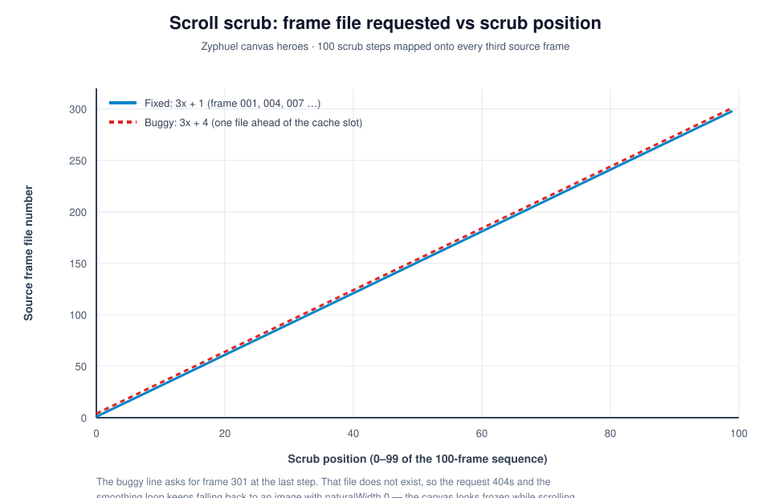
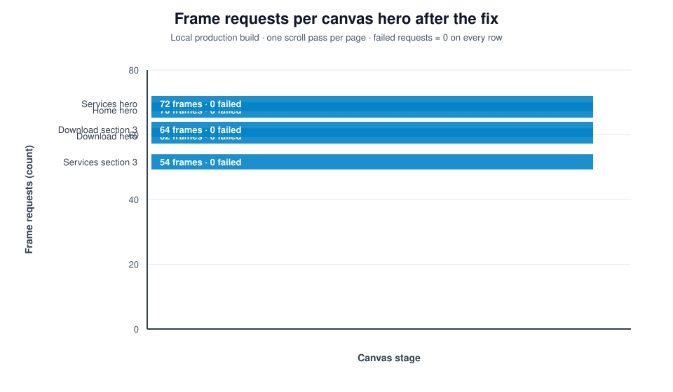
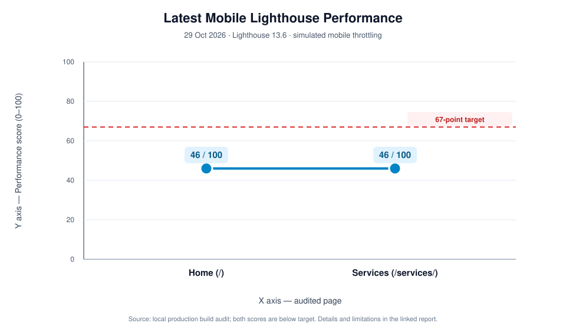
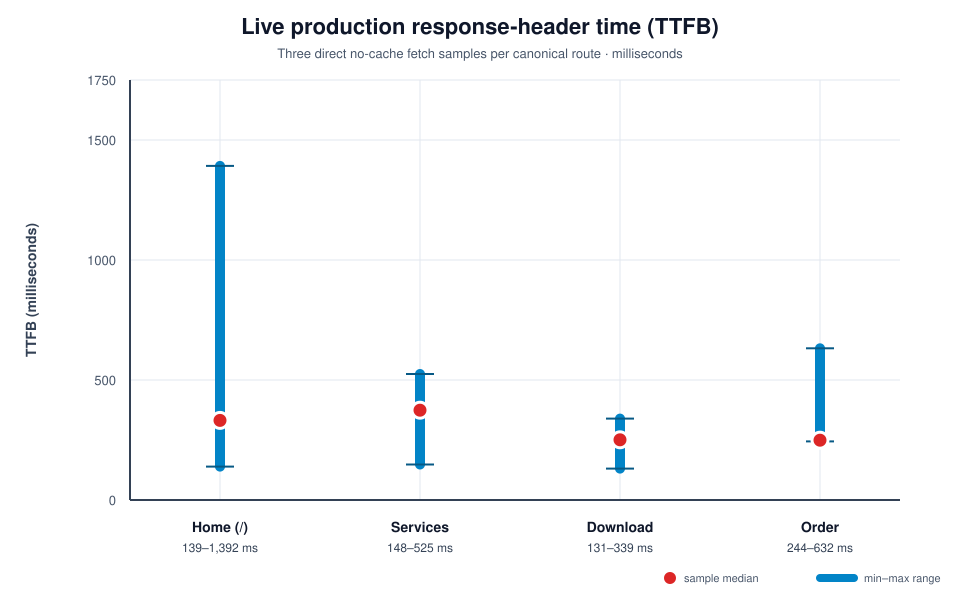
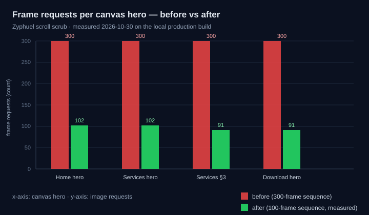

# Zyphuel — Reports Hub

**Last updated:** 2026-10-30
**Repository:** `github.com/daniyal44/Zyphuel` (branch `main`)

This is the single entry point for every audit, QA pass and change report on the Zyphuel website. Each report below is committed and pushed; the graphs in this file are rendered from the same numbers the reports themselves contain.

> **Fresh production-path observation (2026-10-29):** three no-cache requests each for `/`, `/services/`, `/download/`, and `/order/` returned 200. Uncached TTFB ranged **139–1,392 ms** on Home, **148–525 ms** on Services, **131–339 ms** on Download, and **244–632 ms** on Order. The observed variation is edge/network response time, distinct from localhost application work; headers show `public,max-age=0,must-revalidate`. A live Home browser visit also fetched five below-fold carousel images totalling about **2.4 MiB** while rendering the `/order/` route; see the current report for a targeted fix and caveats.

> **Latest mobile Lighthouse result (2026-10-29): Home 46/100, Services 46/100.** The 67-point target was not met. [Open the standalone report](./2026-10-29-mobile-lighthouse-home-services.md).

## Latest: 2026-10-30 fixes (report + 2D graphs)

**Working hours corrected** — order intake is daily 8:00 AM – 10:00 PM; the support desk runs Mon–Thu 8:00 AM – 10:00 PM and Fri–Sun 10:00 AM – 6:00 PM. The contradictory "Every day 8:00 AM – 10:00 PM" block mixed two different schedules under one unlabelled heading, and Friday's half-day row is now gone.

**Scroll animations fixed** — the canvas scrub requested `file(i × 3 + 4)` instead of `file(i × 3 + 1)`, so the last step asked for a frame that does not exist and the loop kept falling back to an empty image.





[Open the 2026-10-30 report](./2026-10-30-hours-fix-and-performance.md)

---



> Every chart on this page is a committed SVG file under [`charts/`](./charts/), generated by `node scripts/make-report-charts.cjs`. They are real images, so they display on GitHub, in the editor and in a plain browser — no renderer, extension or internet connection is needed.

---

## 1. How the documentation fits together


| Stage | Folder | Question it answers |
| :--- | :--- | :--- |
| Plan | `docs/plans/` | What did we set out to do? |
| Audit | `docs/audits/` | What was measured, and how bad was it? |
| QA | `docs/qa/` | Did it actually work after the change? |
| Report | `docs/reports/` | What changed, by how much, and on whose authority? |
| Log | `docs/changes.md` | In what order did the whole project happen? |

---

## 2. Every report in the repository

| Date | Report | Type | Score / Headline | File |
| :--- | :--- | :--- | :--- | :--- |
| **2026-10-30** | **Scroll animation, live-site speed & hours/indexing** | Report | 1,500 frames 97.5 MB → 50.9 MB · carousel 18.7 MB → 1.0 MB · 3 URLs technically indexable, owner actions listed | [`2026-10-30-scroll-frames-speed-indexing-report.md`](./2026-10-30-scroll-frames-speed-indexing-report.md) |
| **2026-10-29** | **Mobile Lighthouse — Home & Services** | Report | Home 46 · Services 46 · target 67 not met | [`2026-10-29-mobile-lighthouse-home-services.md`](./2026-10-29-mobile-lighthouse-home-services.md) |
| **2026-10-29** | **Scroll, production speed & operating-hours investigation** | Report | 5 canvas heroes, 4 routes, 19-URL sitemap; 3 unindexed claims are not fixed by code alone | [`2026-10-29-scroll-speed-indexing-report.md`](./2026-10-29-scroll-speed-indexing-report.md) |
| **2026-10-28** | **Search Console Indexing & Visibility Report** — read from the owner's Coverage + Performance exports | Report | 14 indexed / 3 not · 1 click / 17 impressions (question-filtered) · 5 code fixes | [`docs/reports/2026-10-28-search-console-indexing-report.md`](./2026-10-28-search-console-indexing-report.md) |
| **2026-10-26** | **Whole Website Report** — every route, its weight, depth, meta, schema and features | Report | 17 routes · 25,129 words · 148 images · 0 meta violations | [`docs/reports/2026-10-26-whole-website-report.md`](./2026-10-26-whole-website-report.md) |
| **2026-10-21** | Competitor Gap, Responsiveness & Performance Audit | Audit | Home desktop 86–99, mobile 66; `/download/` mobile **34** | [`docs/audits/2026-10-21-audit.md`](../audits/2026-10-21-audit.md) |
| **2026-10-26** | Full Manual QA & Health Report | QA | **81 / 100** across 9 categories | [`docs/qa/2026-10-26-full-qa-report.md`](../qa/2026-10-26-full-qa-report.md) |
| **2026-10-26** | Complete Website Change Report | Report | 60 files · +1,812 / −658 · 9 commits | [`docs/reports/2026-10-26-website-changes-report.md`](./2026-10-26-website-changes-report.md) |
| **ongoing** | Project phase log (Phase 1 → 23) | Log | 1,300+ lines of chronological history | [`docs/changes.md`](../changes.md) |
| **2026-10-26** | Keyword map & routing plan | Plan | Money + PAA + long-tail + AI prompts | [`docs/plans/2026-10-26-keyword-map.md`](../plans/2026-10-26-keyword-map.md) |

---

## 3. QA score by area — 2026-10-26


| Area | Score | One-line reason |
| :--- | :---: | :--- |
| Security / anti-spam | 98 | 17 pages clean; one fake Baidu token removed |
| AEO | 92 | 18-question FAQ schema survives hydration |
| GEO | 90 | `llms.txt` corrected; 30+ AI crawler rules |
| Technical SEO | 95 | 17/17 pages pass; all meta inside SERP limits |
| Build integrity | 87 | 17/17 routes prerender, 0 errors |
| Mobile | 82 | Order stepper fixed; contact table still scrolls |
| Performance | 78 | 73 MB dead video + 328 MB frames still deployed |
| Accessibility | 75 | All images have `alt`; some small icon buttons |
| **Content trust** | **55** | **Regulatory claims need a licence number** |

**Weighted overall: 81 / 100.**

---

## 4. Latest mobile Lighthouse result — 2026-10-29

The latest local production-build run used Lighthouse 13.6 with simulated mobile throttling. Both routes scored **46/100**; the prior 97/98 readings used `provided` throttling and are not comparable. LCP was the analytics-consent text, at 9.7 s on Home and 8.4 s on Services.


See the [standalone report](./2026-10-29-mobile-lighthouse-home-services.md) and the [detailed audit notes](../audits/2026-10-28-mobile-lighthouse-audit.md#16-home-and-services-poster-change-follow-up).

## 4a. Scroll animation, live delivery speed, indexing & operating hours — 2026-10-29

The five frame-based canvases now use a shared, idempotent loader and repaint the current target after its image load; the Home carousel defers assigning sources to its visible cards until its section is near the viewport. The Home operating-hours card now labels the daily 08:00–22:00 PKT order window separately from weekday/weekend support-desk hours. These are code changes; no claim is made that the local edits are deployed yet.

A direct production `fetch` sample measured the four canonical pages at HTTP 200, with uncached TTFB ranges above. In the live browser session, a route transition to `/` timed out twice, while a separate page session initially remained on `/order/` and fetched five hidden carousel images (~2.4 MiB); thus real browser rendering felt slower than local dev and the remote session itself was unstable. Current production HTML has canonical + index/follow directives, and the sitemap includes all three `/services/`, `/download/`, `/order/` URLs (19 total); these facts do not establish that Google has indexed them.

The GSC export summary dated 2026-10-28 reports 14 indexed / 3 not indexed and only question-query-filtered performance (1 click, 17 impressions). The referenced `D:\\Games\\...` report folders are outside this workspace and not accessible here; the earlier checked-in export-derived report is the source available in this checkout. Search Console must be checked again after requesting a crawl; ranking citywide or at the top for every keyword cannot be guaranteed by site edits.



**Same day follow-up (2026-10-30, later):** the WebP pass cut bytes but the scrub still stalled. The five canvas heroes moved from a 300-frame sequence to every third frame (100 files each) with an ahead-only lookahead and a capped idle fill. On the local production build a real wheel scroll on `/` went from *timing out after 15 s* to completing instantly, and Home's mobile frame requests dropped from 242 to 102 (Services hero 102, Services §3 91, Download hero 91 — each changing the canvas at every sampled position). Full detail and the before/after chart are in [`2026-10-30-scroll-frames-speed-indexing-report.md`](./2026-10-30-scroll-frames-speed-indexing-report.md) §8.



---

## 5. Where the site stood before the 2026-10-26 fixes

Lighthouse Performance, measured on the 2026-10-21 build (desktop reported as the range across runs; mobile is a single run).


> Dark blue = desktop (best run), light blue = mobile. Mobile is the reason this round of work happened: `/download/` scored **34** and `/services/` **56**, both driven by megabytes of frame-sequence images rather than by JavaScript.

| Page | Desktop | Mobile | Mobile blocker |
| :--- | ---: | ---: | :--- |
| `/download/` | 88 | **34** | Two sticky canvas stages — "Style & Layout" 6.3 s, TBT 2,600 ms |
| `/services/` | 93 | **56** | 300-frame hero preloading ~6 MB on cellular |
| `/order/` | 98 | **61** | Frame-sequence hero is the LCP element |
| `/about/` | 97 | 64 | Font-loading CLS (since fixed) |

---

## 6. Change mix — the 2026-10-26 round

60 files changed across 9 commits, **+1,812 / −658** lines.


---

## 7. Timeline of the 2026-10-26 session


---

## 8. What is still open, and who can close it


| # | Open item | Owner | Why it is blocked |
| :--- | :--- | :--- | :--- |
| 1 | Request Indexing in Search Console for `/order/`, `/download/`, `/services/` | **Owner** | Needs the owner's Google login |
| 2 | Confirm or soften the OGRA / NFPA / weights-and-measures claims | **Owner** | Only the owner knows whether the licences exist |
| 3 | Decide whether LPG and water stay on the order page | **Owner** | A business decision, not a bug |
| 4 | Register the IndexNow key in Bing Webmaster Tools | **Owner** | Bing returns 403 until the site is verified there |
| 5 | Remove the 73 MB of unused video still deployed | Agent | — |
| 6 | Add `width`/`height` to 55 hotlinked Unsplash images | Agent | — |
| 7 | Fix the contact page coverage table on phone widths | Agent | — |
| 8 | Move to a custom domain | Owner / Agent | Domain purchase and DNS access |

---

## 9. How to regenerate the automated numbers

```bash
npm install
npm run build                        # vite build + SSR build + prerender 17 routes
node scripts/qa-static.cjs           # per-page PASS/FAIL table -> scratch/qa-static.json
node scripts/report-stats.cjs        # per-page facts for the report -> scratch/report-stats.json
node scripts/make-report-charts.cjs  # regenerates every SVG in docs/reports/charts/
npx vite preview --port 4174         # then inspect in a browser
```

`node scripts/qa-static.cjs` checks, on every prerendered page: H1 count, title and description length, canonical, duplicate ids, JSON-LD validity, ``, missing assets, broken internal links, and any leftover "urgent" copy.
