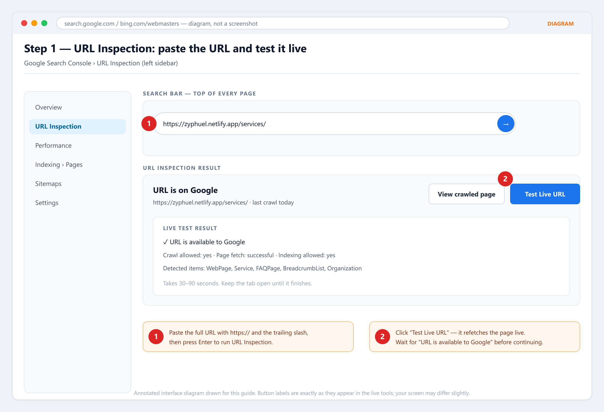
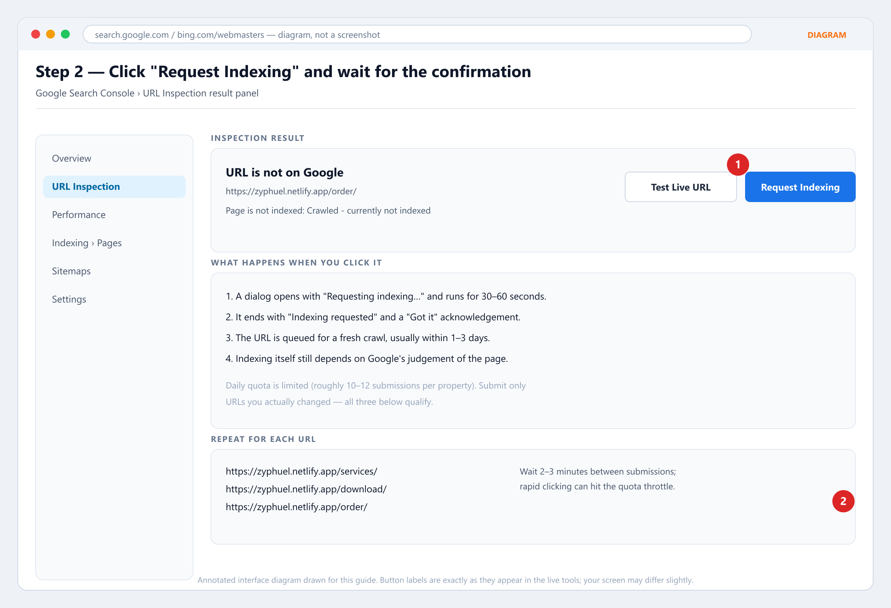
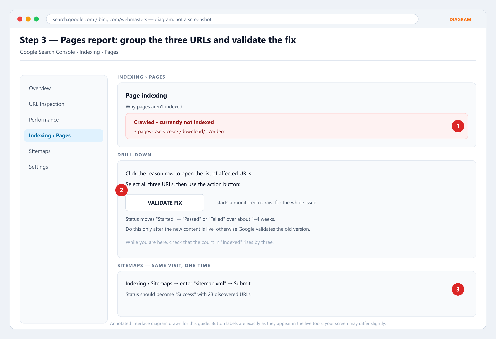
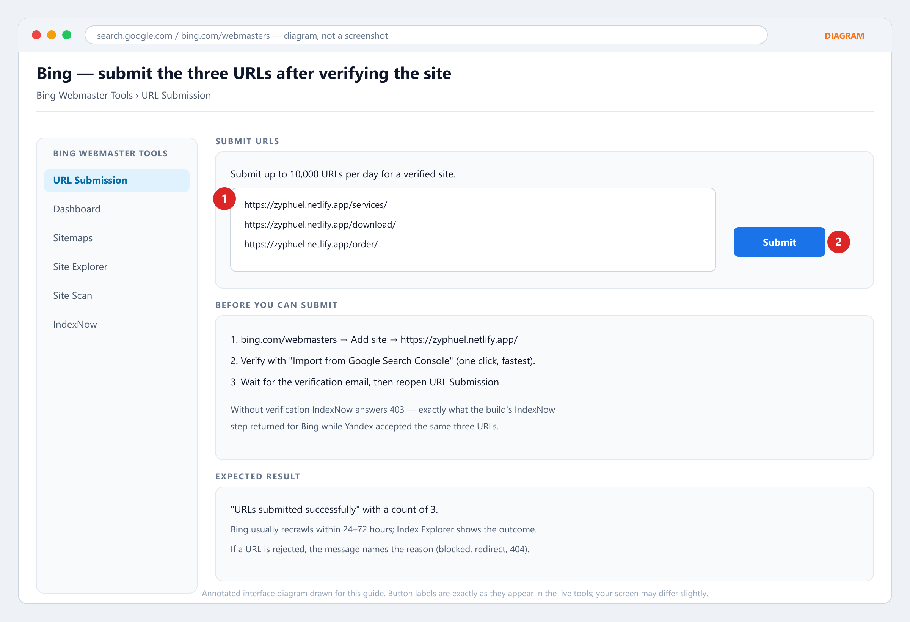

# Request indexing for `/services/`, `/download/` and `/order/` — click-by-click

**Date:** 31 October 2026
**Target URLs:**

1. `https://zyphuel.netlify.app/services/`
2. `https://zyphuel.netlify.app/download/`
3. `https://zyphuel.netlify.app/order/`

**About the images:** these are **annotated interface diagrams**, not screenshots. Nobody can screenshot your Search Console — it is behind your Google login, and this workspace has no access to it. Every label in the diagrams is the exact button text in the live tools, so you can find the control on your own screen. If a screenshot of your actual account would help, take one and it can be annotated instead.

---

## 0. Before you start (2 minutes)

| Check | How | Expected |
| :--- | :--- | :--- |
| The new content is live | Open each URL in a normal browser, scroll to the bottom of the hero | You should see the heading "Fuel delivery services in Lahore…", "Installing the Zyphuel APK…", "How to order fuel online in Lahore…" |
| Property is the right one | Search Console top-left property selector | `https://zyphuel.netlify.app/` (URL-prefix property, **not** a `sc-domain` one) |
| You are signed in as an owner/full user | Top-right avatar | Your own account, not a shared viewer |
| Sitemap has 23 URLs | Open `https://zyphuel.netlify.app/sitemap.xml` | 23 `<loc>` entries, the three target URLs read `lastmod` 2026-10-31 |

If the live pages do **not** show the new sections, stop: a Netlify deploy is still pending, and requesting indexing now would ask Google to crawl the old version.

---

## 1. Google Search Console — URL Inspection (per URL, three times)



1. Open **https://search.google.com/search-console** and pick the `https://zyphuel.netlify.app/` property.
2. In the left sidebar click **URL Inspection**. (Diagram marker 1.)
3. Paste the full URL into the search bar at the top — include `https://` and the trailing slash — and press **Enter**.
4. Wait for the inspection panel. You will see one of:
   - **"URL is on Google"** — already indexed. Skip to the next URL, nothing else to do.
   - **"URL is not on Google"** — continue to step 5.
5. Click **Test Live URL** (Diagram marker 2) and wait 30–90 seconds. Do not close the tab.
6. Read the **Live test** block. It must say:
   - `✓ URL is available to Google`
   - `Crawl allowed: yes`
   - `Page fetch: successful`
   - `Indexing allowed: yes`

   If any of these is negative, stop and fix that first — see §5.

**What to expect:** the live test is a real fetch by Googlebot, so it is the strongest check available to you. It usually takes under a minute; on a slow connection it can take two.

---

## 2. Google Search Console — Request Indexing



7. In the same panel, click **Request Indexing** (Diagram marker 1). It only appears after the live test has completed and the page is indexable.
8. A dialog opens: *"Requesting indexing…"*. Wait 30–60 seconds.
9. It ends with **"Indexing requested"** and a **Got it** button. That is your receipt — the URL is queued.
10. Repeat steps 2–9 for the other two URLs (Diagram marker 2).

**What to expect at each step:**

| Moment | What you see | What it means |
| :--- | :--- | :--- |
| Immediately | "Indexing requested" | The URL is queued for a fresh crawl. It does **not** mean indexed. |
| 1–3 days | The URL Inspection panel changes from "URL is not on Google" to "URL is on Google" | The crawl happened and the page was accepted. |
| 3–14 days | The URL starts appearing in `site:zyphuel.netlify.app` and in Pages → Indexed | Indexed and eligible to rank. |
| Longer | Panel still says "Crawled – currently not indexed" | Google crawled it but judged it not worth indexing yet. Not a technical fault — see §5. |

**Quota:** roughly 10–12 Request Indexing submissions per property per day. Three URLs is well inside it. Do not resubmit the same URL every day; it does not speed anything up.

---

## 3. Google Search Console — Pages report and Validate Fix



11. Left sidebar → **Indexing › Pages**.
12. Under **Why pages aren't indexed**, click the row **Crawled - currently not indexed** (Diagram marker 1). Open it and confirm the three URLs are listed there. This tells you Google has already crawled them and grouped them for the same reason.
13. Select the three URLs and click **VALIDATE FIX** (Diagram marker 2). This starts a monitored recrawl for the whole issue.
14. Same visit: sidebar → **Sitemaps**, enter `sitemap.xml`, click **Submit** (Diagram marker 3). Status should become **Success** with 23 discovered URLs.

**What to expect:** Validate Fix status goes `Started` → then either `Passed` or `Failed` over roughly 1–4 weeks. `Passed` means Google confirms the issue is gone for the pages it re-crawled; it does not force an index. If it fails, the row tells you which URL still fails and why.

**Important order of operations:** Validate Fix runs *after* the site changes are live. Running it before a deploy validates the old HTML and usually fails.

---

## 4. Bing Webmaster Tools (do this after Google)



15. Open **https://www.bing.com/webmasters** and sign in.
16. **Add site**: `https://zyphuel.netlify.app/`.
17. **Verify** with the fastest method: choose **Import from Google Search Console** and approve. Alternatives are an XML file at the site root, a `<meta>` tag, or a DNS CNAME — none are needed if the import works.
18. Wait for the confirmation email.
19. Left sidebar → **URL Submission**, paste the three URLs **one per line**, then click **Submit** (Diagram markers 1 and 2).
20. Optional: sidebar → **IndexNow** to confirm the key file is being served (`https://zyphuel.netlify.app/<key>.txt`).

**Why this matters here:** the build already pings IndexNow on every deploy. Yandex accepted the three URLs (`200`), but Bing returned `403 UserForbiddedToAccessSite` because the property is not verified in Bing Webmaster Tools. Verification is the single blocker, and step 17 removes it.

**What to expect:** "URLs submitted successfully" with a count of 3. Bing normally recrawls within 24–72 hours; **Index Explorer** shows the result per URL.

---

## 5. If a check fails — what it means and what to do

| Symptom in the tool | Meaning | Fix |
| :--- | :--- | :--- |
| `Crawl allowed: no` | `robots.txt` blocks the path | Check `public/robots.txt`; the live file allows `/` for Googlebot and only blocks `/404.html`, `/api/`, `/plugins/` |
| `Indexing allowed: no` | A `noindex` is being served | Check the `<meta name="robots">` tag **and** the `X-Robots-Tag` response header |
| `Page fetch: failed` | Server error or timeout on Googlebot's fetch | `curl -I` the URL; must be `200` within a couple of seconds |
| `Duplicate, Google chose different canonical` | Another URL is treated as the real page | Confirm the live HTML has `<link rel="canonical" href="…/services/">` pointing at itself |
| `Alternate page with proper canonical tag` | Google sees this URL as a copy | Usually means a deploy served the SPA shell instead of the prerendered page — rebuild and resubmit |
| `Soft 404` | Page looks empty/error-like when rendered | Check that the prerendered HTML contains the H1 and body text, not just `<div id="root">` |
| `Crawled - currently not indexed` | Crawled, judged not worth indexing yet | Not a tag fault. Improve the page and build authority — this round added the depth content for exactly this reason |
| `Discovered - currently not indexed` | URL known, never crawled | Normal on a low-authority subdomain; Request Indexing moves it along |
| Bing returns `403` on submit | Site not verified | Complete step 17 |

---

## 6. Copy-paste checklist

```
[ ] Live /services/ shows the new "Fuel delivery services in Lahore" block
[ ] Live /download/ shows the new "Installing the Zyphuel APK" block
[ ] Live /order/ shows the new "How to order fuel online in Lahore" block
[ ] GSC property = https://zyphuel.netlify.app/

[ ] URL Inspection: /services/  -> Test Live URL -> Request Indexing
[ ] URL Inspection: /download/  -> Test Live URL -> Request Indexing
[ ] URL Inspection: /order/     -> Test Live URL -> Request Indexing

[ ] Indexing > Pages > "Crawled - currently not indexed" > VALIDATE FIX
[ ] Indexing > Sitemaps > submit sitemap.xml > Success, 23 URLs

[ ] Bing Webmaster Tools > Add site > verify via GSC import
[ ] Bing > URL Submission > 3 URLs > Submit
```

---

## 7. Realistic timeline (and what not to do)

| Day | Expected state |
| :--- | :--- |
| Day 0 | Three "Indexing requested" receipts, sitemap Success, Bing submission accepted |
| Days 1–3 | Googlebot refetches; URL Inspection flips to "URL is on Google" for at least one of the three |
| Days 3–14 | Pages → Indexed grows; impressions begin to appear for the targeted queries |
| Weeks 2–6 | Ranking movement — slowest part, depends on links, reviews and local signals, not on resubmission |

Do **not**:

- resubmit the same URL daily (no effect, burns quota),
- run Validate Fix before the deploy is live,
- add `noindex` "temporarily" while waiting,
- change the URLs (a new path resets everything you just queued).

**Honest expectation:** a code fix cannot cause indexing. Google decides. What this round guarantees is that when Google does look, it finds a page with unique content, a self-canonical, one H1, valid JSON-LD and a FAQ schema that matches the visible text.
